# New-user journeys, November 2026 (before 3.0 GA)

**Question:** can a newcomer succeed with nothing but the published documentation (mateu.io) and the
released artifacts — Maven Central / NuGet / PyPI **3.0-beta.51**?

**Method:** six newcomers, one per path, each in an empty folder outside the repository, starting
from *Start here → Choose your path* and following only what the pages say. Milestones per path:
create the project, run it, a first screen, a CRUD (listing + record + create), a menu, and the
deployment step that can be done locally. Every milestone was driven in a real browser (Playwright,
Chromium) and captured under [`journeys/`](journeys/). Machine: macOS, default JDK 26, Maven 3.9.9,
.NET SDK 9.0.100, Python 3.14, Node 23.

## Verdict

| # | Path | Entry page | Result | Wall time* |
|---|---|---|---|---|
| 1 | Java + Spring Boot MVC | Java quickstart → archetype | ✅ all milestones | ~6 min |
| 2 | Java + Quarkus | Create your project › Quarkus | ✅ all milestones (after guessing step 1 and the run command — fixed) | ~8 min |
| 3 | C# (.NET) | C# manual | ✅ all milestones, but only by inventing the project setup (no from-scratch section — fixed) | ~8 min |
| 4 | Python (FastAPI) | Python manual | ✅ all milestones, same gap as C# (fixed) | ~6 min |
| 5 | YAML served by Spring Boot | Quickstart: YAML | ✅ listing out of the box; record + create only by stitching three pages and a demo (fixed with a new section) | ~12 min |
| 6 | Static bundle, no backend | Quickstart: YAML › static flavour | ✅ all milestones, `mateu-bundle:dev` live reload included | ~6 min |

\* agent time, artifacts already in the local Maven cache for the Java paths; a human first run
adds the downloads.

Nothing **failed** on the released artifacts: every generated project built and booted on the first
try, including on JDK 26 (only the archetype itself needs 21–25, which the docs say). The frictions
are all on the documentation side, and the worst were the two non-Java manuals having no "start
from an empty folder" path at all.

## 1. Java + Spring Boot (MVC)

Steps: `mvn archetype:generate … -DarchetypeVersion=3.0-beta.51 -Dauthoring=code` with JDK 21 (as
the caution box says) → `mvn package` on the default JDK 26 → `java -jar target/my-app-1.0.0-SNAPSHOT.jar`
→ home, Products listing, record P-002, create P-005 (validation rejects an empty Status first,
then saves) → added the first-app tutorial's `Hello` screen to the menu.

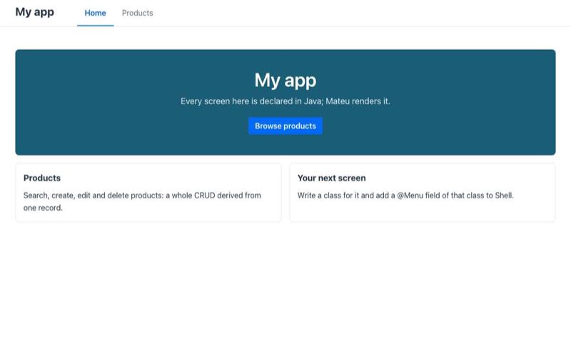 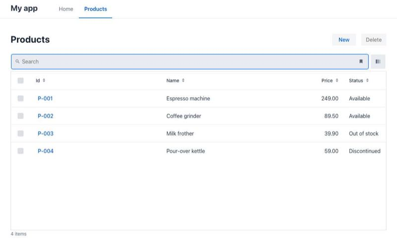
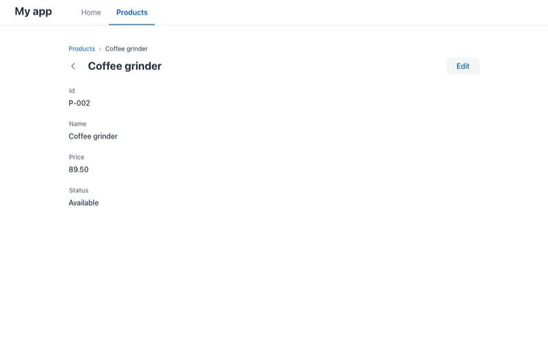 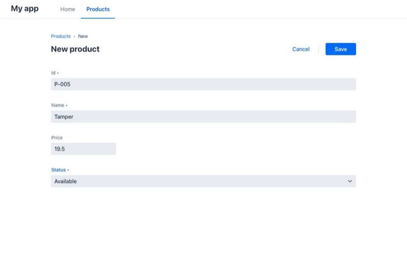
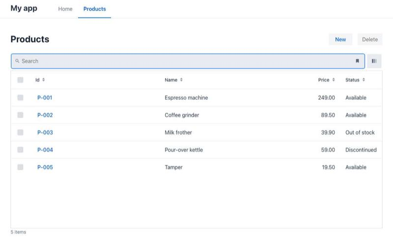 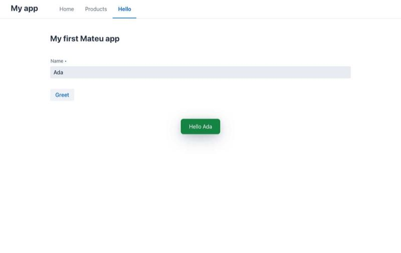

| Severity | Page › section | What happened | Fix |
|---|---|---|---|
| Medium | Java quickstart › tip, Create your project › table, YAML quickstart › 1, Choose your path › front doors | The archetype command says `-DarchetypeVersion=<release>`: the reader has to go and find the latest release, although the site already substitutes `MATEU_VERSION` everywhere else | **Fixed**: the commands use `MATEU_VERSION` (rendered as 3.0-beta.51) |
| Medium | First app › "In a generated project" | Pasting the tutorial's `public class Home` into the generated project clashes with its own `Home.java`; the note's advice (`@UI("/hello")`) builds, but the screen is then its own app — a deep link to `/hello` renders it without the shell/menu | **Fixed**: call it `Hello`, no `@UI`, add `@Menu Hello hello;` to `Shell` (verified: `/hello` renders inside the shell) |
| Low | Java quickstart › caution | Archetype needs JDK 21–25; on JDK 26 it breaks. Documented, but JDK 26 is now the default download | Listed below (archetype plugin's Groovy) |

## 2. Java + Quarkus

Steps: Quarkus's own generator (`quarkus-maven-plugin:create -Dextensions=rest-jackson`, Quarkus
3.40.1.1, release 25) → the page's BOM, dependencies and processor path → its `HelloWorld` → `mvn
package` → `java -jar target/quarkus-app/quarkus-run.jar` → replaced `HelloWorld` with the
quickstart's Java classes (minus the Spring `Application`) → CRUD + menu; `mvn quarkus:dev` checked
too.

 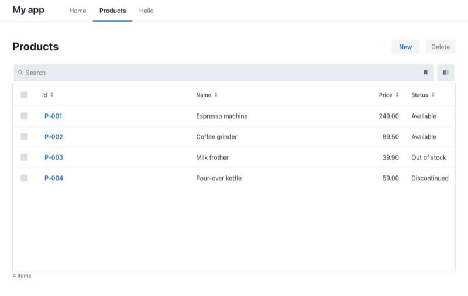
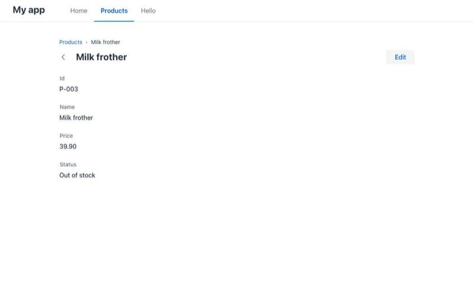 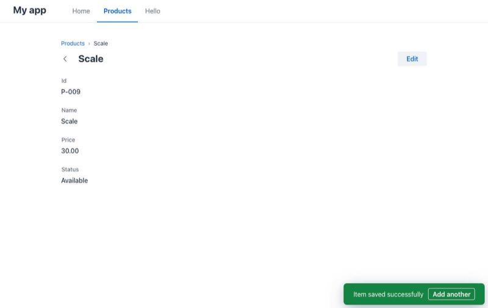

| Severity | Page › section | What happened | Fix |
|---|---|---|---|
| Medium | Quarkus › Step 1 | "Obviously you need a valid Quarkus project" — no command, no hint that `rest-jackson` is the extension to pick | **Fixed**: the generator command + code.quarkus.io + the starter |
| Medium | Quarkus › Step 3 | "…you will find your ui at http://localhost:8080 as expected:" — the sentence ends in a colon with nothing after it, and the page never says how to run the app | **Fixed**: `mvn quarkus:dev` / `java -jar target/quarkus-app/quarkus-run.jar`, what to expect |
| Medium | Quarkus › end | From an empty `@UI` the only way forward was "copy the starter"; nothing says the quickstart's classes run unchanged | **Fixed**: says so, and that `Shell` and `HelloWorld` both take the root path |
| Low | Quarkus › Step 2 | Where the Mateu BOM goes relative to the Quarkus BOM is not said (either order worked) | not changed |

## 3. C# (.NET)

Steps: `dotnet new web -n MyApp` → `dotnet add package Mateu.AspNetCore --prerelease` (resolved
3.0.0-beta.51; the template targets net9.0 and uses the net8.0 build) → `Program.cs` from the page
→ the Forms example (`/person`) → a `Crud<Product>` + `[App]` shell → renderer jar from Central with
`MATEU_UI` → listing, record, create → `dotnet publish -c Release` and run the dll.

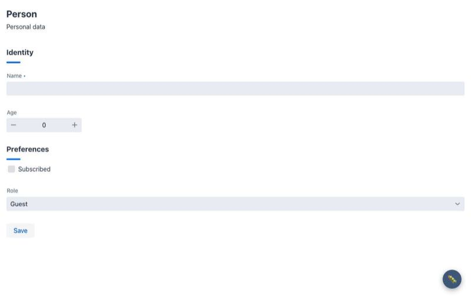 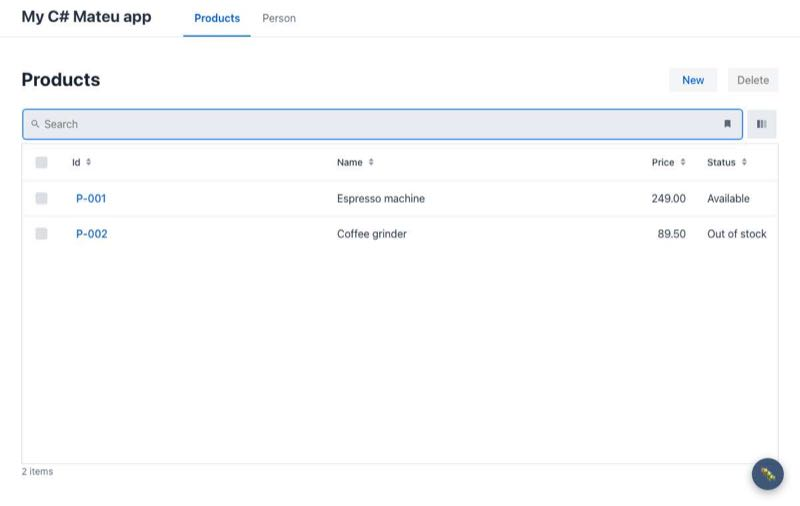
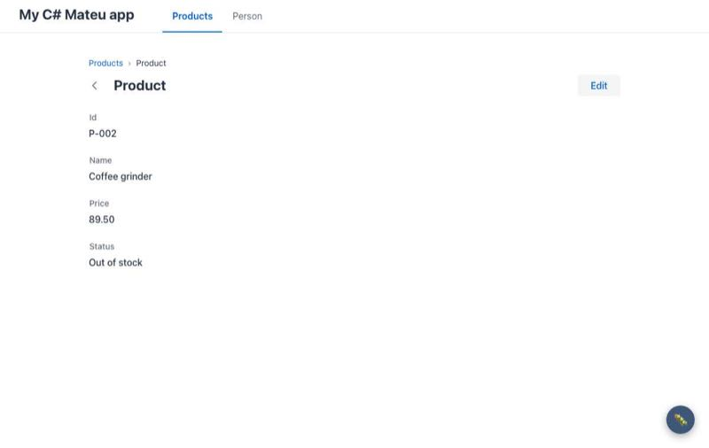 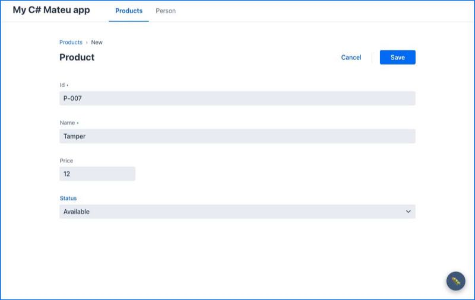
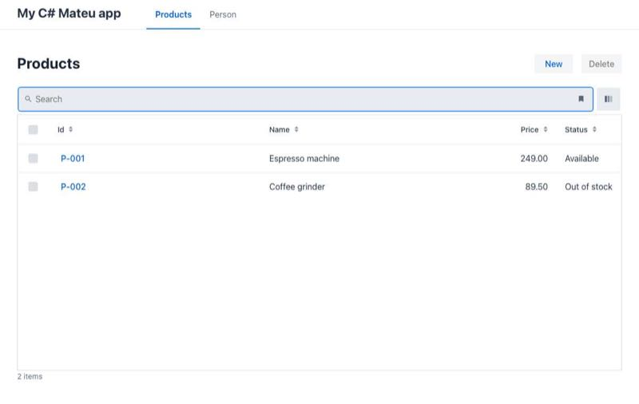

| Severity | Page › section | What happened | Fix |
|---|---|---|---|
| **High** | C# › Install / Run it | No "new project" path: after `dotnet add package` the page goes straight to *Run it from the repository* (`cd backend/dotnet`). A newcomer has to guess `dotnet new web`, which file holds what, and how the shell, CRUD and renderer jar fit together. `starters/dotnet` cannot be copied as is either: it references the repository's projects | **Fixed**: new *Start a new project* section (commands, `Program.cs`, a CRUD + shell, the renderer jar, publish) — the snippet was extracted from the page and run |
| Medium | C# › Install | "the release `v3.0-alpha.N` is `3.0.0-alpha.N` on NuGet" — out of date | **Fixed** (beta) + the net9.0 note |
| Medium | Production checklist › 1. Package | No .NET or Python row, and nothing says these servers do **not** carry the renderer (the Java artifacts do) | **Fixed**: two rows + that sentence |
| Low | — | In `Development` a 🐛 button appears bottom right; nothing explains it | **Fixed**: one line in the new section |
| Low | C# › CRUD | The record page is titled with the class name ("Product"); Java uses the entity's `toString()` | Listed below |
| Low | Choose your path › C# tab | `Store.Search(...)` is not defined anywhere | covered by the new section's full example |

## 4. Python (FastAPI)

Steps: `python3 -m venv` (3.14) → `pip install "mateu-ui[server]"` (3.0.0b51, FastAPI 0.162) →
`views.py` with the Forms example, a `Crud[Product]` and an `@app` shell → `main.py` from the page
→ renderer jar with `MATEU_UI` → listing, record, create.

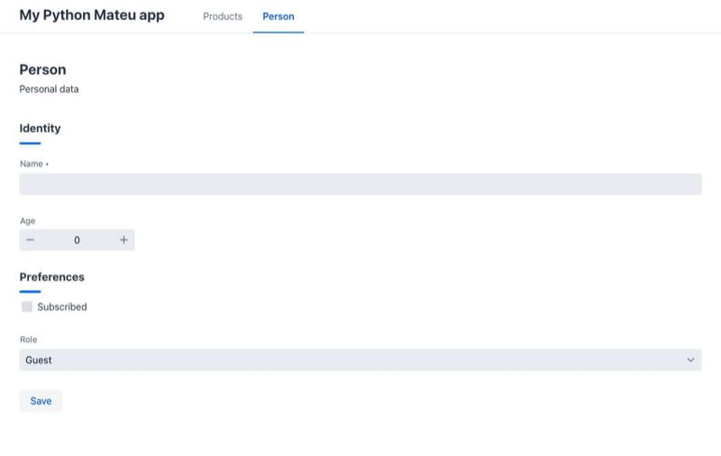 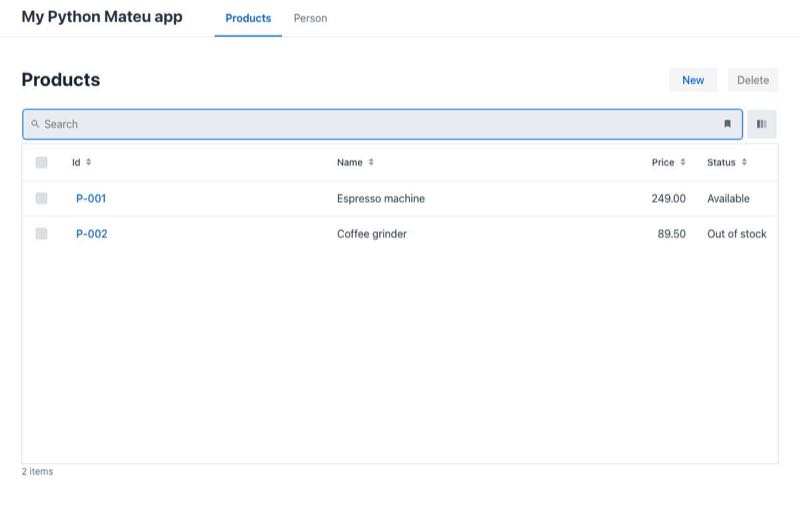
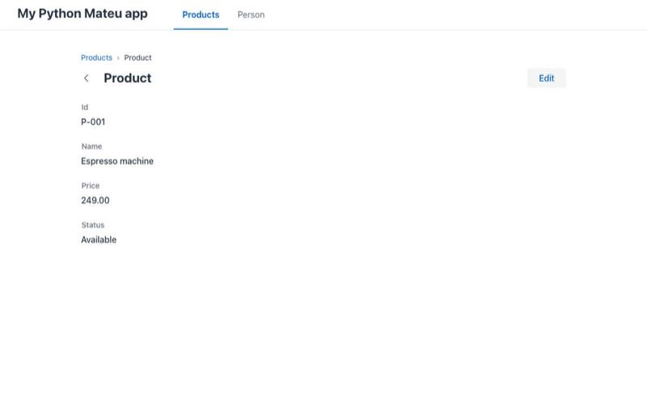 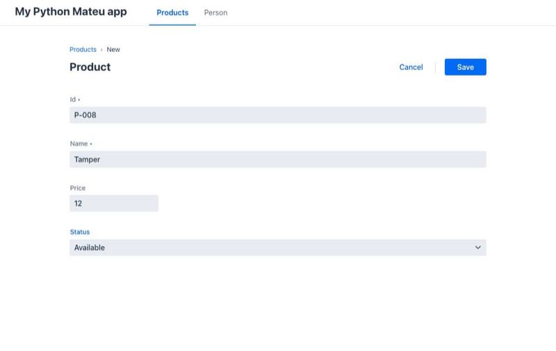

| Severity | Page › section | What happened | Fix |
|---|---|---|---|
| **High** | Python › Run it | Same as C#: the only run instructions are from a repository checkout (`pip install -e`, `samples.demo`) | **Fixed**: *Start a new project* (venv, `views.py`, `main.py`, the jar, deploy) — extracted and run |
| Medium | Python › Install | "the `v3.0-alpha.N` release publishes `3.0.0aN`" — out of date; "3.11–3.13 tested" while 3.14 is what a new Mac gets | **Fixed** (beta; 3.14 seen to work) |
| Low | Python › Run it | "The server binds to `0.0.0.0`" — uvicorn binds `127.0.0.1` unless `--host 0.0.0.0` | **Fixed** |

## 5. YAML only, served by Spring Boot

Steps: archetype `-Dauthoring=yaml` → `mvn package` → run the jar → home and Products listing out
of the box → record page and create form added (see below) → rebuilt and run.

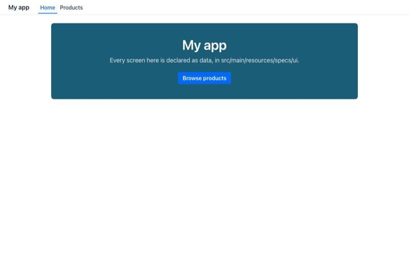 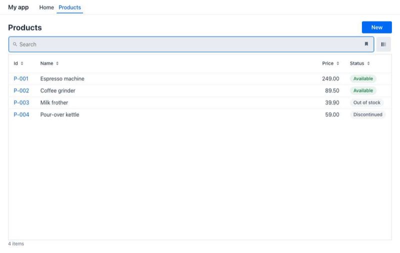
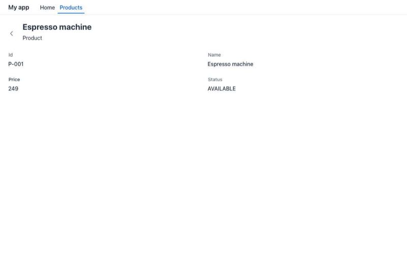 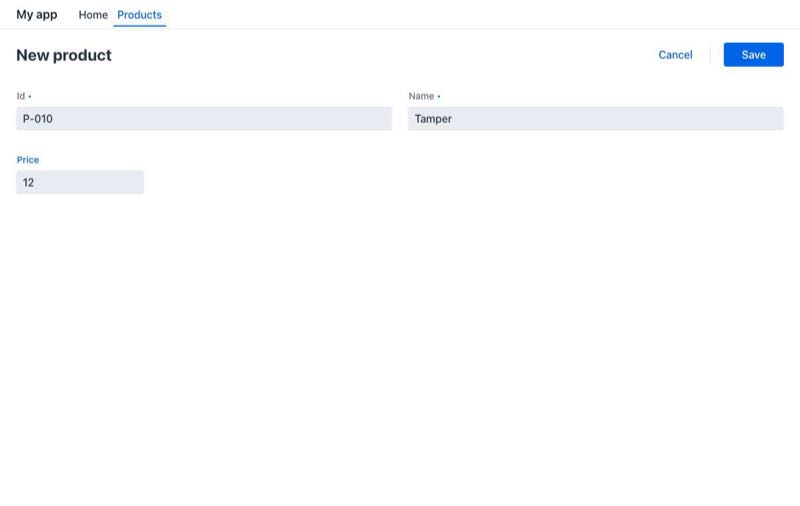

| Severity | Page › section | What happened | Fix |
|---|---|---|---|
| **High** | Quickstart: YAML | The quickstart stops at a listing. Turning it into a CRUD needed: `rowRoute` (a row of a table in *A 100 % static UI*), `data:` on a route (*Routes and mounts*), that `:id` is read as `${state.id}` (only in a comment of `demo-static-vcn`'s `routes.yaml`), and `actions:` + `restAction` on a `Form` (the same table, plus the demo's `vcn.yaml`) | **Fixed**: new section *4. Open a record and create one* — five snippets, verified on the served app and on the static bundle |
| Medium | (same) | In sample mode every record shows the same sample, whatever the id — looks like a bug until you know a `sample:` is one fixed response | **Fixed**: said in the new section |
| Low | — | The record page shows `249` and `AVAILABLE` where the listing shows `249.00` and `Available` (read-only `FormField`s don't format unless told) | not changed |

## 6. Static bundle, no backend

Steps: archetype `-Dauthoring=static` → `mvn package` → `npx serve -s target/mateu-bundle` →
home, listing → the same record/create specs as path 5 → `mvn mateu-bundle:dev` (an edit rebuilt in
143 ms and showed up on reload).

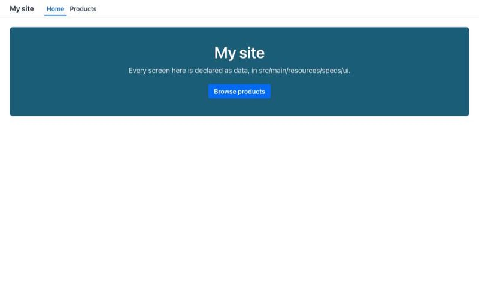 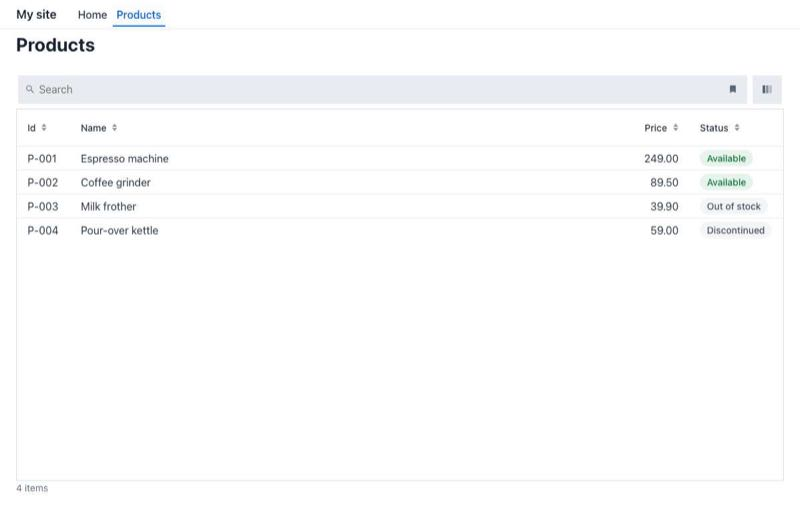
 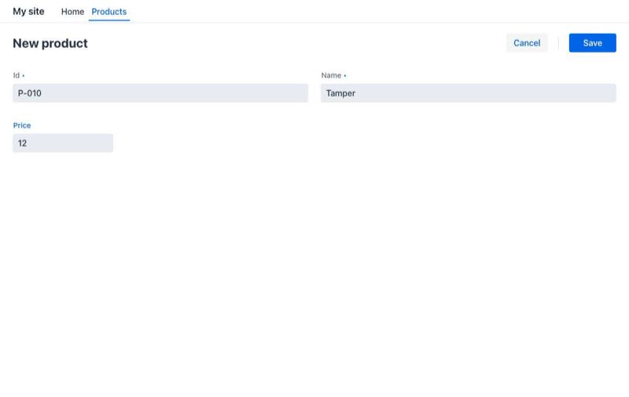

No new friction beyond path 5's. `staticOnly` accepted the create form (its button has a
`restAction`), and the record/create pages expand in the browser (`specsOnly`).

## What was fixed (this PR)

- `java-user-manual/start-here/quickstart.md`, `java-create-your-project/index.md`,
  `define/yaml/quickstart.md`, `start-here/choose-your-path.mdx`: archetype version = `MATEU_VERSION`.
- `java-user-manual/start-here/first-app.md`: the generated-project note.
- `java-create-your-project/quarkus.md`: step 1, how to run, from the empty class to the quickstart.
- `csharp-user-manual/index.md`, `python-user-manual/index.md`: *Start a new project*; version lines;
  bind address.
- `define/yaml/quickstart.md`: *4. Open a record and create one*.
- `deploy/production-checklist.md`: .NET and FastAPI rows; the renderer jar for the ports.
- `start-here/choose-your-path.mdx`: the .NET/Python rows point at the new sections.

`npm run verify` passes. No starter, generator or code change was needed: every generated project
worked as generated.

## Left for later (bigger than a doc fix)

1. **The archetype on JDK 26+.** The archetype plugin's Groovy cannot read class files of major 70,
   so `mvn archetype:generate` fails on the JDK most people now download (documented, but it is
   the first command of two quickstarts). Options: a newer Groovy in the archetype's post-generate
   step, or doing the replacements without Groovy.
2. **No archetype for the non-Spring runtimes.** Quarkus/Micronaut/Helidon start from the
   framework's own generator plus hand edits, .NET/Python from the docs' new sections or the IDE
   wizards. A `-Druntime=quarkus` on the archetype (the starters already exist) would give them a
   one-command start.
3. **`starters/dotnet` and `starters/python` cannot be copied** out of the repository: they reference
   the repository's sources (`ProjectReference`, `-r ../../backend/python/requirements.txt`). The
   generators rewrite that; a reader following "copy a starter" does not.
4. **Record title in the ports**: `.NET`/Python CRUD record pages are titled "Product" (the class),
   Java's use the entity's `toString()`.
5. **YAML record pages don't format**: a read-only `FormField` shows the raw `249` / `AVAILABLE`
   that the listing renders as `249.00` / `Available`.
