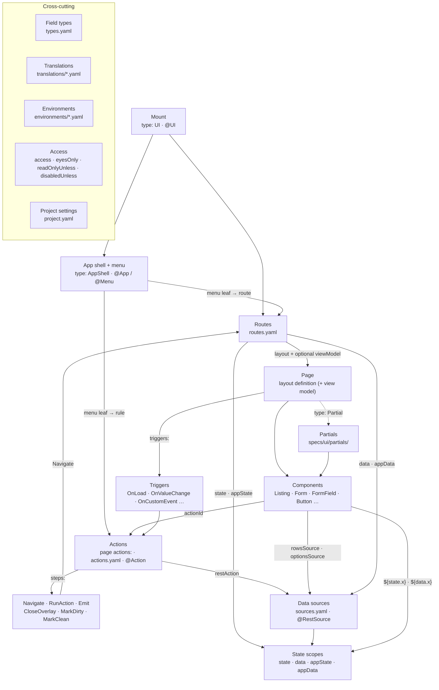

import { Tabs, TabItem } from '@astrojs/starlight/components';

A Mateu UI is a small set of **building blocks**. Each one has a name, a job and a home, and the
same blocks exist whichever way you author them: as YAML files under `specs/ui/` (by hand or with
the [visual editor](/define/yaml/visual-editor/)), or as code in Java, C# or Python. Whichever way
you write them, they become one model. That model renders in Vaadin or Redwood on the web, in the
React Native app and in IntelliJ. A backend in Java, .NET or Python can serve it, or it can ship as a
[static bundle](/deploy/static-bundle/) with no backend at all. Several UIs can also be
[federated](/mateu-about/ui-federation/) into one console.

This page is the map. Each section below describes one block with the same template, and links to the
page that covers it in depth.

## How the blocks connect



Read it top to bottom. The **mount** is the app at a base path. Its **app shell** draws the chrome
and the **menu**, and the **routes** map each URL of the mount to a **page**. A page is a **layout**
(a tree of **components**, possibly pulling in **partials**) and optionally a **view model** that
holds behaviour. Components name **actions**. An action is either a flow of **steps** that runs in the
browser, a REST call against a **data source**, or a method on a server. Data flows into four **state
scopes** that the components read with `${…}`, and **triggers** run actions with no click at all.
Across all of it, **field types**, **translations**, **environments**, **access** rules and the
**project settings** apply wherever they are referenced.

## The running example

Every example on this page, and on the concept pages it links to, builds the same small app: a
**product catalogue**, the one the [YAML starter](/define/yaml/quickstart/) generates. Its whole
`specs/ui/` folder:

```text
specs/ui/
├── app.ui.yaml          ← the mount        (type: UI)
├── app.yaml             ← the app shell    (type: AppShell)
├── routes.yaml          ← the routes       (type: Routes)
├── products.yaml        ← a page           (a Listing)
├── product.yaml         ← a page           (a Form for one product)
├── partials/
│   └── price-block.yaml ← a partial
├── actions.yaml         ← the action catalogue    (type: Actions)
├── sources.yaml         ← the data sources        (type: Sources)
├── types.yaml           ← field types             (type: Types)
├── translations/es.yaml ← translations            (type: Translations)
├── environments/pre.yaml← an environment          (type: Environment)
└── project.yaml         ← project settings        (type: Project)
```

Every file declares what it is with `type:`, so Mateu finds it by its content, not by its name. All
of them are validated by one generated schema, `specs-schema.json`, which also gives your editor
completion.

---

## Mount

| | |
|---|---|
| **What it is** | A UI application served at a base path. Every other block belongs to a mount. |
| **What it's for** | Giving the app an address (`/`, `/back-office`), naming its home page, and listing the route files that make it up. Several mounts can live in one project or be federated into one console. |
| **Where it lives** | A file with `type: UI` anywhere under `specs/ui/` (the starter calls it `app.ui.yaml`), or a class annotated `@UI`. |
| **Served vs static** | A server serves the mount at its base path. A static bundle exports one mount, with its routes, into `manifest.json`. |

<Tabs syncKey="authoring">
<TabItem label="YAML">

```yaml
# specs/ui/app.ui.yaml
type: UI
basePath: /
home: products          # the route the mount opens on
routes:
  - routes.yaml
```

</TabItem>
<TabItem label="Java">

```java
@UI("")                 // the mount at the root; the class is its root view
@Title("Catalogue")
public class Catalogue { … }
```

C#: `[UI("…")]` on a class. Python: `@ui("…")`.

</TabItem>
</Tabs>

More: [Routes & mounts](/concepts/routes-and-mounts/).

## App shell and menu

| | |
|---|---|
| **What it is** | The chrome around every page: title, logo, variant (menu on top, hamburger, tabs, tiles), header widgets and the **menu**. |
| **What it's for** | Navigation. A menu leaf either **routes** somewhere (`RouteLink`) or **runs** something (`RuleLink`, which runs an action). Groups (`Menu`) nest leaves, and `RemoteMenu` pulls in the menu of another Mateu service. |
| **Where it lives** | A `type: AppShell` definition bound to the mount's root route `""`, or an `@App` class with `@Menu` fields (or an `AppSupplier` that composes it in code). |
| **Served vs static** | The server builds the shell per request, so menu items the caller may not open are dropped. A bundle ships it, and its flows run in the browser. |

<Tabs syncKey="authoring">
<TabItem label="YAML">

```yaml
# specs/ui/app.yaml
type: AppShell
title: Catalogue
variant: MENU_ON_TOP
menu:
  - type: RouteLink
    label: Products
    route: products
  - type: RuleLink               # runs an action instead of navigating
    label: New product
    rules:
      - action: RunAction
        actionId: newProduct     # from actions.yaml
```

</TabItem>
<TabItem label="Java">

```java
@UI("")
@App(AppVariant.MENU_ON_TOP)
@Title("Catalogue")
public class Catalogue {
  @Menu Products products;       // a menu entry routing to the Products screen
}
```

C#: `[App]` with `[MenuItem]` methods, or `IAppSupplier`. Python: `@app` with `@menu_item`, or
`AppSupplier`.

</TabItem>
</Tabs>

More: [App shell and menus](/concepts/app-shell-and-menus/), and the shell's variants, header and
overlays in [structure of an app](/ux/app-structure/).

## Routes

| | |
|---|---|
| **What it is** | The route table of a mount. Each entry binds a URL, relative to the mount, to a **layout**, an optional **view model** and parameters. |
| **What it's for** | Deciding what each URL shows. One page can answer several routes (with `fixedParams` / `defaultParams`), one layout can serve several view models, and a route can have **no** view model at all. Entries can nest (`children`), be restricted (`access`) and seed state (`state`, `appState`, `data`, `appData`). |
| **Where it lives** | `routes.yaml` (`type: Routes`), listed by the mount. In code, a `RouteEntrySupplier`. An `@UI` class contributes its own route. |
| **Served vs static** | Route resolution runs on the server *and* in the browser with the same precedence: `fixed > client state > path > query > defaults`. The authored table travels in the bundle's `manifest.json`. |

<Tabs syncKey="authoring">
<TabItem label="YAML">

```yaml
# specs/ui/routes.yaml
type: Routes
routes:
  - route: ""                    # the mount root → the app shell
    layout: app.yaml
  - route: products
    layout: products.yaml
  - route: products/:id
    layout: product.yaml
    data: product                # fetch the record from sources.yaml on entry
```

</TabItem>
<TabItem label="Java">

```java
@Service
public class CatalogueRoutes implements RouteEntrySupplier {
  @Override public List<RouteEntry> routes() {
    return List.of(RouteEntry.of("products", "com.acme.catalogue.Products"));
  }
}
```

C#: `IRouteEntrySupplier`. Python: `RouteEntrySupplier`. All three also read `routes.yaml`.

</TabItem>
</Tabs>

More: [Routes & mounts](/concepts/routes-and-mounts/).

## Pages

| | |
|---|---|
| **What it is** | What a route renders: a **layout definition**, which is a tree of components rooted at one component (`Listing`, `Form`, `VerticalLayout`…), plus, optionally, a **view model** that supplies state, behaviour and validation. |
| **What it's for** | Being a screen. Most business screens belong to a handful of families (a listing, a record, a form, a guided process, a dashboard, a landing page), and Mateu has a starting point for each. |
| **Where it lives** | A YAML file under `specs/ui/`, named by a route's `layout:`. In code, a class: an annotated view model from which Mateu *derives* the layout, or a `ComponentTreeSupplier` that builds it. |
| **Served vs static** | A page with a view model needs a server. A page without one is pre-rendered into the bundle, or shipped raw and expanded in the browser. |

<Tabs syncKey="authoring">
<TabItem label="YAML">

```yaml
# specs/ui/products.yaml
type: Listing
title: Products
searchable: true
rowsSource:
  ref: products                  # a data source
rowRoute: products/${row.id}     # a row opens the record page
columns:
  - {type: GridColumn, id: name, label: Name}
  - {type: GridColumn, id: price, label: Price, fieldType: Money}
  - {type: GridColumn, id: status, fieldType: ProductStatus}
```

</TabItem>
<TabItem label="Java">

```java
@Title("Products")                // routed as `products` (see Routes above)
public class Products extends AutoCrud<Product> {   // listing, form and detail, derived
  @Override public CrudStore<Product> store() { return ProductStore.INSTANCE; }
}
```

C#: `class Products : Crud<Product>`. Python: `class Products(Crud[Product])`.

</TabItem>
</Tabs>

More: [Pages and components](/concepts/pages-and-components/). For what pages look like (the six
[page types](/ux/page-types/), their anatomy and the component catalogue), see the
[UX guide](/ux/).

## Partials

| | |
|---|---|
| **What it is** | A named piece of layout (one component or a list of them) with no route, title or chrome. |
| **What it's for** | Reusing a piece of screen anywhere a component can go. A multi-component partial is **spliced** into its parent, so it works inside forms and grids. |
| **Where it lives** | `specs/ui/partials/<name>.yaml`, used with `type: Partial` + `ref:`. In Java, `new Partial("…")`, or a `ref` naming a class. |
| **Served vs static** | Resolved before anything reaches the wire, so no renderer has to know about partials and a bundle stays self-contained. |

<Tabs syncKey="authoring">
<TabItem label="YAML">

```yaml
# specs/ui/partials/price-block.yaml
content:
  - {type: FormField, id: price, label: Price, fieldType: Money}
  - {type: FormField, id: status, fieldType: ProductStatus}
```

```yaml
# used in specs/ui/product.yaml
- type: Partial
  ref: price-block
```

</TabItem>
<TabItem label="Java">

```java
FormLayout.builder()
    .content(List.of(
        FormField.builder().id("name").label("Name").build(),
        new Partial("price-block")))
    .build();
```

Java, C# and Python all resolve file partials. Only Java resolves a `ref` that names a class.

</TabItem>
</Tabs>

More: [Partials](/define/yaml/partials/). For a reusable piece that is also *bound to a data source*,
see [business components](/java-ui-definition/component-catalogue/).

## Actions

| | |
|---|---|
| **What it is** | What runs when a button, menu leaf, row click, shortcut or trigger names an `actionId`. An action is either a **flow** of `steps`, a **REST call** (`restAction`), or a **server method**. |
| **What it's for** | Behaviour. A flow's steps are `Navigate`, `RunAction` (another action, which may be on a server), `Emit` (an event other components subscribe to), `CloseOverlay`, `MarkDirty` and `MarkClean`. A `restAction` reads or writes through a data source. |
| **Where it lives** | A page's `actions:`, the shell's `actions:`, or the **action catalogue** (`actions.yaml`, `type: Actions`), which declares an action once for every page. Resolution is owner first, then the catalogue, then the server. In Java, `@Action` / `@Button` methods, or an `ActionCatalogSupplier`. |
| **Served vs static** | Flows and REST calls run in the browser, so they also work in a bundle and in Play. A server method, or a `proxy: true` call, needs a server. |

<Tabs syncKey="authoring">
<TabItem label="YAML">

```yaml
# specs/ui/actions.yaml
type: Actions
actions:
  - id: newProduct
    steps:
      - type: MarkClean
      - type: Navigate
        route: products/new
  - id: discontinue
    access: {roles: [manager]}
    restAction:
      source: {ref: product-discontinue}
      successMessage: Discontinued
```

</TabItem>
<TabItem label="Java">

```java
public class ProductPage {
  String id;

  @Button
  public Message discontinue() {        // a server action; its id is the method name
    ProductStore.INSTANCE.discontinue(id);
    return new Message("Discontinued");
  }
}
```

C#: `[Button]` methods, `IActionCatalogSupplier`. Python: `@button()`, `ActionCatalogSupplier`.

</TabItem>
</Tabs>

More: [Actions](/concepts/action-catalogue/), and in Java [actions](/java-ui-definition/actions/).

## Data sources

| | |
|---|---|
| **What it is** | A named REST endpoint, declared once, which any surface references by name: listing rows, select options, a route's data, an action's call. |
| **What it's for** | Keeping the URL, the response mapping (`itemsPath`, `fields`, `totalPath`), `proxy` and secrets in one place, so a deployment can be re-pointed without touching a screen. `sample:` data lets a screen show realistic rows before the API exists. |
| **Where it lives** | `sources.yaml` (`type: Sources`). In Java, `@RestSource` on any registered class or a `RestSourceCatalogSupplier`. A surface refers to a source with `ref:` (YAML) or `source = "…"` (annotations). |
| **Served vs static** | The catalogue travels with the app (or once in the bundle's manifest). The browser calls endpoints directly, and `proxy: true` sends the call through the server, which injects `${secret.X}`. Sample data is used only in sample mode: always in the visual editor, and in a bundle or app only when you opt in. |

<Tabs syncKey="authoring">
<TabItem label="YAML">

```yaml
# specs/ui/sources.yaml
sources:
  - name: products
    source: {url: /api/products}
    sample:
      - {id: P-001, name: Espresso machine, price: 249.0, status: AVAILABLE}
  - name: product
    source: {url: "/api/products/${state.id}"}
```

</TabItem>
<TabItem label="Java">

```java
@UI("")
@RestSource(name = "products", url = "/api/products")
@RestSource(name = "product", url = "/api/products/${state.id}")
public class Catalogue { … }

@UI("/rest-products")
@RestListing(source = "products")          // rows fetched by the browser
public class RestProducts implements Listing<RestProducts.Row> { … }
```

C#: `[RestSource("products", "/api/products")]`, `IRestSourceCatalogSupplier`. Python:
`@rest_source(...)`, `RestSourceCatalogSupplier`.

</TabItem>
</Tabs>

More: [Data sources](/concepts/data-sources/).

## State and data scopes

| | |
|---|---|
| **What it is** | The four bags of values a screen reads and writes: `state` (the page's field values), `data` (extra page data that isn't a field), `appState` (app-wide values that persist across navigation) and `appData` (app-wide data, fetched once). |
| **What it's for** | Binding. A `FormField id: name` reads and writes `state.name`. Any label, title or URL can say `${state.name}`, `${data.total}`, `${appState.hotel}`. Rules and conditions read the same scopes. |
| **Where it lives** | Seeded by a route (`state`/`appState` as literals, `data`/`appData` as references to sources), filled by sources and actions, and carried by every request. In code, the view model's **fields** are its state, and an action returns `State`, `Data`, `AppState` or `AppData` to change the others. |
| **Served vs static** | Identical. The browser holds the scopes and sends them back with each request to a server, while in a bundle they never leave the browser. |

<Tabs syncKey="authoring">
<TabItem label="YAML">

```yaml
# a route seeding scopes on entry
- route: products/archived
  layout: products.yaml
  state: {status: DISCONTINUED}   # literal → state
  appData: catalogue-totals       # a source → appData, fetched once
```

</TabItem>
<TabItem label="Java">

```java
public class ProductPage {
  String id;                      // state.id, filled from the :id path parameter
  String name;                    // state.name

  @Button
  public Data refreshTotals() {
    return new Data(Map.of("total", ProductStore.INSTANCE.count()));   // → data.total
  }
}
```

</TabItem>
</Tabs>

More: [State, scopes and triggers](/concepts/state-and-triggers/).

## Triggers

| | |
|---|---|
| **What it is** | An action that runs without a click: `OnLoadTrigger`, `OnValueChangeTrigger`, `OnCustomEventTrigger`, `OnSuccessTrigger`, `OnErrorTrigger` and `AutoSaveTrigger`. |
| **What it's for** | Loading on entry, polling, reacting to a field change, refreshing when another component emits an event, saving as the user types. |
| **Where it lives** | A page's `triggers:` (or a `Listing`'s). In Java, `@Trigger(type = …, actionId = …)`, `@SubscribeTo`, `@AutoSave` or a `TriggersSupplier`. |
| **Served vs static** | Triggers fire in the browser. Whether the action they run needs a server depends on the action. |

<Tabs syncKey="authoring">
<TabItem label="YAML">

```yaml
triggers:
  - type: OnCustomEventTrigger
    eventName: product-saved
    actionId: refresh
```

</TabItem>
<TabItem label="Java">

```java
@SubscribeTo(event = "product-saved", action = "refresh")
public class ProductsDashboard { … }
```

C#: `[SubscribeTo("event", "action")]`. Python: `@subscribe_to("event", "action")`.

</TabItem>
</Tabs>

More: [State, scopes and triggers](/concepts/state-and-triggers/#triggers).

---

The blocks below are **cross-cutting**. They don't sit at one place in the tree. Instead, they apply
wherever something references them.

## Field types

| | |
|---|---|
| **What it is** | A named domain concept (`ProductStatus`, `Money`, `Email`): label, data type, stereotype, options, alignment, status tones. |
| **What it's for** | Declaring a concept once instead of repeating `dataType: money, align: end` on every field and column. A field or column names one with `fieldType:`, and whatever the field declares itself still wins. |
| **Where it lives** | `types.yaml` or any `specs/ui` file declaring `type: Types`, or a `FieldTypeCatalogSupplier`. The Java analogue for annotated classes is a [semantic annotation](/java-ui-definition/annotations/semantic-annotations/). |
| **Served vs static** | Resolved on the authored tree before it becomes components, by the server, the browser expander and the ports alike. The wire never carries `fieldType`. |

```yaml
# specs/ui/types.yaml
type: Types
types:
  - id: ProductStatus
    label: Status
    dataType: status
    options:
      - {value: AVAILABLE, label: Available}
      - {value: DISCONTINUED, label: Discontinued}
    tones: {AVAILABLE: success, DISCONTINUED: neutral}
  - id: Money
    dataType: money
    align: end
```

More: [Field types](/java-ui-definition/field-types/).

## Translations

| | |
|---|---|
| **What it is** | One message catalogue per locale. Any label, title or text says `${i18n.key}`. |
| **What it's for** | A multilingual UI that uses one set of files, whether it is authored in YAML or in Java. |
| **Where it lives** | `specs/ui/translations/<locale>.yaml` (or `type: Translations` anywhere). In code, a `TranslationsSupplier` or your own `Translator`. C#: `ITranslationsSupplier`. Python: `TranslationsSupplier`. |
| **Served vs static** | A server resolves the keys per request, so every renderer gets finished text. A bundle ships the catalogue and the browser resolves it. |

```yaml
# specs/ui/translations/es.yaml
messages:
  products: {title: Productos, new: Nuevo producto}
```

More: [Translations](/define/yaml/translations/).

## Environments

| | |
|---|---|
| **What it is** | Per-deployment overrides of data sources: `baseUrl`, `url`, `headers`, `proxy`. Secrets never go in these files. |
| **What it's for** | Pointing the same screens at `pre`, `pro` or a local stack without editing `sources.yaml`. |
| **Where it lives** | `specs/ui/environments/<name>.yaml` (or `type: Environment`). This is deployment configuration with no code twin: select an environment with `MATEU_ENVIRONMENT` / `-Dmateu.environment`. |
| **Served vs static** | A server applies the overlay at startup. A bundle is built for one environment (`-Dmateu.bundle.environment`), or you re-point it by editing its manifest. |

```yaml
# specs/ui/environments/pre.yaml
sources:
  products: {baseUrl: https://pre.api.example.com}
```

More: [Environments](/deploy/environments/).

## Access

| | |
|---|---|
| **What it is** | Who may see, reach or use something, by `roles`, `groups`, `scopes` or `permissions` (AND across dimensions, OR within one). |
| **What it's for** | `access:` on a route, menu item or action (refused → hidden, or 403). `eyesOnly`, `readOnlyUnless` and `disabledUnless` on any component. |
| **Where it lives** | Inline, on the block it restricts. In Java, `@EyesOnly`, `@ReadOnlyUnless` and `@DisabledUnless` (C# attributes of the same name, Python `eyes_only`/`read_only_unless`/`disabled_unless`). Identity always comes from what your framework authenticated. Mateu does not authenticate. |
| **Served vs static** | Enforced on the server, per request. A static bundle has no identity, so access rules are cosmetic there, and a `staticOnly` build refuses them. |

```yaml
- route: admin/prices
  layout: prices.yaml
  access: {roles: [manager]}
```

More: [Permissions](/define/yaml/permissions/) and [security](/java-user-manual/advanced/security/).

## Project settings

| | |
|---|---|
| **What it is** | Settings for the whole project. Today that is the renderer: `vaadin` or `redwood`. |
| **What it's for** | Choosing the renderer once. The visual editor's canvas, Play, the static bundle and the IDEs follow that choice. |
| **Where it lives** | `specs/ui/project.yaml` (`type: Project`), one per project. |
| **Served vs static** | A bundle ships the chosen renderer. A served app renders with the renderer jar on its classpath, and the server warns at startup if the two disagree. |

```yaml
# specs/ui/project.yaml
type: Project
renderer: vaadin
```

More: [Project settings](/define/yaml/project-settings/).

---

## Where to go next

- **Build it**: the [YAML quickstart](/define/yaml/quickstart/) generates this catalogue, and the
  [Java quickstart](/java-user-manual/start-here/quickstart/) builds the code version.
- **See all three authoring paths side by side**: [Define the UI](/define/) and
  [Mixing YAML and code](/define/mixing/).
- **See what the blocks look like**: the [UX guide](/ux/): structure of an app, page types,
  components and extension points.
- **Understand the model behind the blocks**: [The model](/mateu-about/the-model/) and
  [the wire](/reference/wire-specification/).
- **Serve or ship it**: [Serve & deploy](/deploy/).
