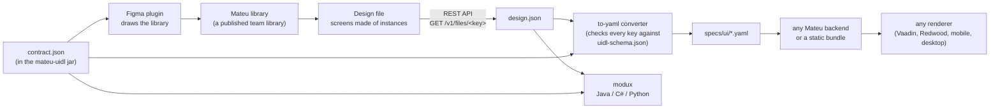

:::caution[Preview]
The Figma pipeline is a **preview** in Mateu 3.0: it is not covered by the stability promise (see
[Known issues](/reference/known-issues/#tooling) and the [Support policy](/reference/support-policy/)).
What is verified and what is not is listed under [Status](#status).
:::

A designer composes screens in Figma with the **Mateu component library**; a developer downloads
the file and one command turns every screen into a Mateu page. There is no hand-off document and
nothing is re-implemented: the YAML the converter writes is what the app serves.

:::tip[Mateu UI Kit on Figma Community]
The component library is published as **[Mateu UI Kit](https://www.figma.com/community/file/1701291643502429777)**: duplicate it to start
designing right away, on any Figma plan.
:::

To set it up and run it, follow **[Figma, step by step](/design-systems/figma-guide/)**. This page
explains how the pieces fit and is the reference for what the library holds and how a design is
read.

## How it works



1. **The contract** — `design/figma/contract.json` in the Mateu repository, also published inside
   the `io.mateu:mateu-uidl` jar at `META-INF/mateu/contract.json`. It lists every Mateu component
   once: its Figma name (`Mateu/<Category>/<Name>`), its variant axes, its config, its editable
   texts, its slots and what it becomes in YAML. Every other piece reads it.
2. **The plugin draws the library** (`design/figma/plugin`). Run in a dedicated Figma file, it
   creates one page per category with one component (or variant set) per contract entry. The result
   is also published on Figma Community as the [Mateu UI Kit](https://www.figma.com/community/file/1701291643502429777), ready to duplicate.
3. **The library is published** as a Figma team library, so design files can use it and receive its
   updates.
4. **Designers compose screens** in their own design file, with instances of the library: one
   top-level frame per page.
5. **The file is downloaded** through Figma's REST API (`GET /v1/files/<key>`), with a personal
   access token that can only read file content.
6. **The converter** (`design/figma/to-yaml`) maps every instance back through the contract. Every
   key it writes is checked against the generated authoring schema (`uidl-schema.json`); what the
   schema does not describe becomes a **warning**, never an invented key.
7. **The YAML pages** land in `specs/ui/`, where any Mateu backend (Java, .NET, Python) serves them,
   or a [static bundle](/deploy/static-ui/) ships them with no backend — and every renderer draws
   them.
8. **modux** reads the same downloaded JSON and the same contract to generate Java, C# or Python
   code instead (see [Generating code (modux)](#generating-code-modux)).

## Status

- **Verified in this repository**: the contract against the generated schema (every authorable
  component has an entry, every key a mapping writes exists); the converter against two Figma REST
  payloads pinned file by file, whose output is then loaded by Mateu's real validator and YAML
  loader (`FigmaYamlGoldenTest`); the plugin with the TypeScript compiler and unit tests of what it
  creates for every entry.
- **Not verified automatically**: the plugin itself — Figma cannot run headless. The library has
  been generated and used in a real Figma file; the plugin's **self-test** command (see
  [Checking the library](#checking-the-library-self-test)) checks the result inside Figma.
- **Not documented by Figma yet**: how slot content appears in the REST API
  ([figma/rest-api-spec#88](https://github.com/figma/rest-api-spec/issues/88)). The converter accepts
  the two plausible shapes (a child of type `SLOT`, or a frame named `slot:<name>`); the test
  fixture for it is synthetic until a real file confirms the shape.

## Reference

### What the library holds

- **Every authorable YAML component** — 161 entries: fields, layouts (sections, tabs, form layouts,
  dashboard and foldout layouts…), display components (notices, metric cards, charts, timelines,
  avatars, badges…), listings with their columns, buttons and toolbars, overlays (drawer, dialog,
  popover). Each component type of the YAML schema has an entry, except the ones that have nothing
  to draw (data and state carriers, raw custom elements, embedded views — the contract's
  `yamlNotDrawn` says why for each). A test keeps it that way: a new YAML component without an entry
  fails the build.
- **Every YAML page template** — one `Mateu/Page Templates/<type>` component per
  [page template](/define/yaml/pages/#page-templates--template), named exactly as the YAML `type`:
  `ItemOverviewPage`, `WelcomePage`, `DashboardLandingPage`, `GeneralOverviewPage`,
  `CollectionDetailPage`, `FoldoutPage`, `MultimediaContentPage`, `AdvancedCreateEditPage`,
  `GuidedProcessPage` and `DataManagementPage`, plus the two parts they hold
  (`GuidedProcessStep`, `DockedPanel`). Each draws the page header (`overline`, `title`,
  `subtitle`), the toolbar slot and the template's own slots (`body`, `footer`, `kpi`, `info`,
  `list`, `noSelection`, `overview`, `detail`, `steps`, `end`, `bottom`) beside `content`; the
  template's fields are variants (`backgroundColor`, `orientation`) or properties (`avatar.src`,
  `avatar.initials`, `photo.src`).
- The **Java archetypes** (`Mateu/Page Templates/Dashboard`, `Wizard`…) stay in the library for the
  modux path; they have no YAML counterpart, and the converter says which YAML template to use
  instead.
- **Slots and properties on every component**: about 90 native slots, about 150 config properties
  (text or yes/no) and about 190 text properties — see below.

### Slots and properties

- **Native slots.** Every named slot of a component (a Section's `content`, a template's `toolbar`,
  `body`, `kpi`…, a Card's or a Drawer's content) is a Figma slot named `slot:<name>`. Designers
  **drag** library instances into it or insert them from the slot's **+**; a toolbar slot offers the
  Button first. The slot grows with what it holds, its grey caption is a hint that is never read, and
  the order inside the slot is the order on the page. (Unnamed dashed areas — a ZonesRow's sample
  columns — are illustration only.)
- **Component properties.** Every component's config — `fieldId`, `actionId`, `route`,
  `rowsSource.ref`, `required`, `readOnly`… — is a property in Figma's **right panel** (a text box, or
  a toggle for yes/no ones), next to its variants. Its texts (`label`, `title`, `subtitle`, a
  placeholder) are text properties too, bound to the layer you see: editing either is the same
  value. Repeated rows are named after their layer (`Title1`, `Title2`).
- **Order of reading**: the variants; then the properties; then — for instances placed with an
  older library — the `#config` text line (`fieldId=email; required=true`) and the text layers. A
  property wins over the same key in `#config`. A text still showing its placeholder is not read.
- **Older libraries keep working.** Before native slots, an instance took no new layers, so a
  Section read the layers that **follow** it in the same frame, up to the next Section, when its
  content slot was empty. The converters still read it that way, and still read `#config`.

### How a design is read

- **One top-level frame per page**; its name becomes the file name (`Fleet` → `fleet.yaml`). Frames
  whose name starts with `_` are scratch and skipped, and so are the library's own `Mateu · …`
  pages.
- **A templated page**: a page template instance — as the screen itself, or inside the screen frame.
  A frame named `slot:<name>` next to the template instance fills that slot; anything else next to it
  is the page's `content`.
- **A free page** is a screen frame without a template: an optional `Mateu/Page/Header` instance
  gives its title, subtitle and toolbar, everything else is its content.
- A plain frame is a layout (horizontal or vertical by its auto-layout, or the layout its name
  says: `FormLayout`); a plain text layer is a `Text` (a heading from 18 px).
- A frame named `partial:<ref>` is shared: it becomes `{type: Partial, ref}` and its content is
  written once to `partials/<ref>.yaml`.
- Hidden layers and layers whose name starts with `#` are notes, never content. A layer of a type
  with no Mateu reading (a widget, a sticky note) is reported as a warning.
- Variants map to the param of the same name; a `false` and the default value are omitted.

### What the converter writes

Each screen becomes a `type: Form` page — with the `template:` its template instance names, the
template's slots filled from what was dropped into them, and the instances inside mapped to their
YAML components. For example, a screen frame `person` holding an `ItemOverviewPage` instance with
Buttons in its toolbar slot, three property-row fields in its `body` slot and a Tabs instance in its
content becomes:

```yaml
type: Form
title: "${state.name}"
subtitle: Character
toolbar:
  - type: Button
    buttonStyle: tertiary
    actionId: backToList
    label: Back to People
    actionable:
      type: RouteLink
      route: people
template:
  type: ItemOverviewPage
  avatar:
    src: "${state.image}"
  body:
    - type: FormField
      id: gender
      dataType: string
      propertyRow: true
      readOnly: true
      label: Gender
content:
  - type: TabLayout
    tabs:
      - type: Tab
        label: Details
        content:
          type: Text
          text: "${state.name} was born on ${state.birth_year}"
```

Every key is checked against the generated authoring schema and every value typed by it
(`maxColumns` = `2` → `2`, `searchable` on → `true`). What the schema does not describe — an unknown
property, a value with no YAML counterpart, a Java-only archetype — is left out and reported as a
warning. Each generated file carries a header comment naming the frame it comes from; regenerate it
from the design rather than editing it.

What a design cannot say stays out: REST sources (`sources.yaml`), routes (`routes.yaml`), the data
a chart or gantt shows, and the actions a button runs beyond its `actionId` / `route`. Keep those in
files of their own.

### Checking the library (self-test)

The plugin has a second command, **Mateu Library Self-test**. Run it in the library file after
generating the library: on a page `Mateu · Self-test` (replaced on each run) it makes an instance of
every entry — the default variant and one more per other value of each variant axis — drops a
library instance into each of its slots, sets each property to a distinctive value and reads it back,
flips each variant axis, and checks that no `#config` line was left behind. A results table at the
top of the page lists every entry (slots ok/total, properties ok/total, failures), Figma shows a
summary, and the plugin console (*Plugins › Development › Show/Hide console*) has the full report as
JSON.

Downloading the library file and running

```bash
cd design/figma/to-yaml && npm run self-test -- library.json
```

converts every instance of that page on its own and fails unless each one becomes a valid component
with no warning (Java archetypes are listed, not failed).

### Generating code (modux)

The [modux](https://github.com/miguelperezcolom/modux) repository reads the same designs into code,
with the contract from the `io.mateu:mateu-uidl` jar:

- its Maven plugin (`figma-maven-plugin`, goal `figma:generate`) turns every designed frame of the
  downloaded JSON (`src/main/figma/*.json`) into a view class under
  `target/generated-sources/figma`: fields with their labels and sections, notices, texts, bulleted
  lists, separators and buttons come out ready; rich display components and wizard/crud frames as
  annotated skeletons with `TODO`s;
- its `importfigma` use case brings the screens — page templates included — into a full modux
  specification (aggregates, use cases, sagas…).

Both read slots and properties exactly like the YAML converter.

See `design/figma/README.md` in the Mateu repository for the contract's format and the
contributor's view of the pipeline.
