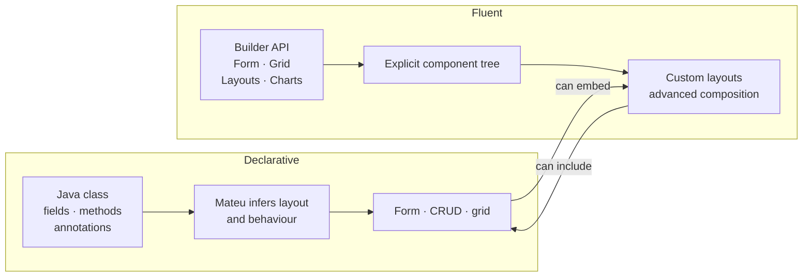

Mateu supports two ways of building UIs. The declarative style uses Java classes and annotations. The fluent style uses a builder API. Both can be combined.

---

## Declarative

:::note[Imports]
The samples leave out their `import` lines and compile with single-type imports. Some names exist
in two Mateu packages (the `@Menu` annotation and the `Menu` record, `@Button` and `Button`…), so
wildcard imports of both packages fail with "reference is ambiguous" — see
[Java imports](/reference/java-imports/).
:::

In the declarative style, the framework infers the UI from your class structure.

```java
@UI("/products/new")
public class NewProductForm {

    @NotBlank
    String name;

    @Stereotype(FieldStereotype.radio)
    ProductStatus status = ProductStatus.Available;

    @Stereotype(FieldStereotype.textarea)
    String description;

    @Button
    @Action(validationRequired = true)
    public Message save() {
        productRepository.save(name, status, description);
        return new Message("Product saved");
    }

}
```

Mateu generates the form layout, field controls, and action buttons from the class. No layout code needed.

### Best for

- Forms and CRUD screens
- Standard admin UIs
- Fast development
- Cases where the domain model maps cleanly to the UI

---

## Fluent

In the fluent style, you build the UI explicitly using Mateu's builder API.

```java
@UI("/dashboard")
public class ProductsDashboard implements ComponentTreeSupplier {

    @Override
    public Component component(HttpRequest httpRequest) {
        return new VerticalLayout(
            Scoreboard.builder()
                .metrics(List.of(
                    MetricCard.builder().title("Total products")
                        .value("" + productRepository.count()).build(),
                    MetricCard.builder().title("Available")
                        .value("" + productRepository.countByStatus(ProductStatus.Available)).build(),
                    MetricCard.builder().title("Out of stock")
                        .value("" + productRepository.countByStatus(ProductStatus.OutOfStock)).build()))
                .build(),
            Chart.builder()
                .chartType(ChartType.bar)
                .chartData(stockService.byCategory()) // a ChartData
                .build()
        );
    }

}
```

You control exactly what is rendered and how it is composed.

### Best for

- Custom dashboards and layouts
- Widgets and data visualizations
- Screens that cannot be expressed with field annotations
- Advanced composition of multiple data sources

---

## Mixing both styles

Declarative and fluent components can be embedded in each other.

A declarative ViewModel can include a `Component` field that is built with the fluent API:

```java
public class ProductForm {

    String name;
    ProductStatus status;

    Component stockChart = Chart.builder()
        .chartType(ChartType.line)
        .chartData(stockService.history(id)) // a ChartData
        .build();

}
```

A fluent layout can embed a declarative ViewModel as a sub-component.

---

## Which to use



Start with the declarative style. Use the fluent style when you need explicit layout control or when the UI cannot be expressed with annotations alone.

---

## Next

- [State, actions and fields](/java-user-manual/concepts/state-actions-and-fields/)
- [Field stereotypes](/java-user-manual/concepts/field-stereotypes/)
- [Action behavior](/java-user-manual/concepts/action-behavior/)
