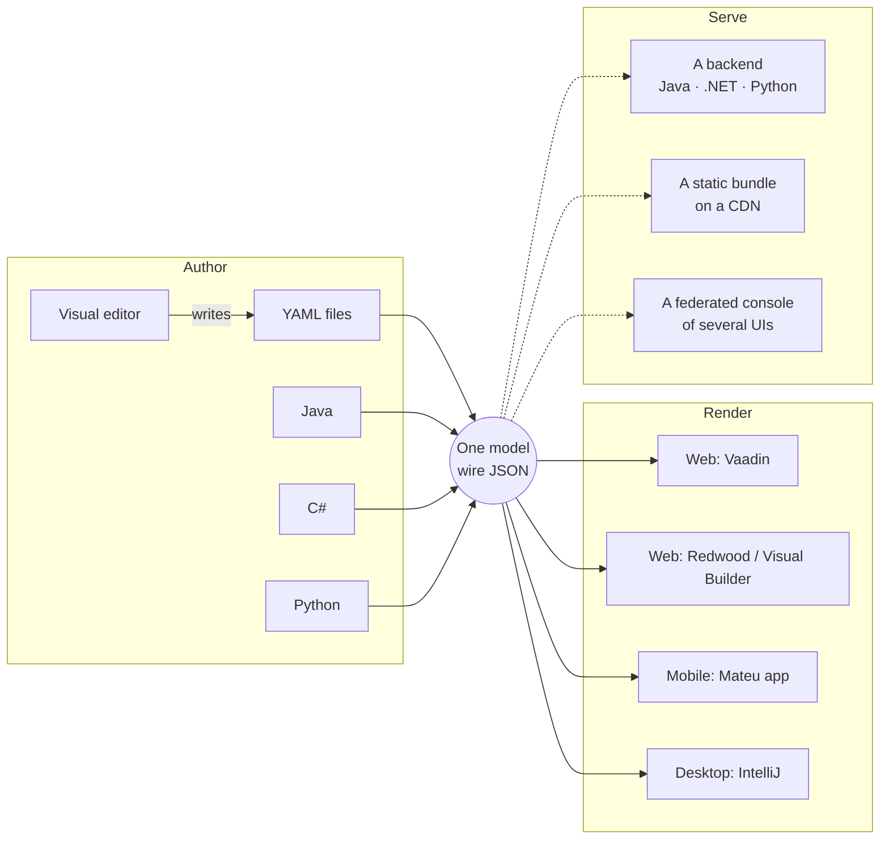

Mateu is a way to define business user interfaces **once, independently of how they are written,
where they render and what serves them**.

You describe a screen — its fields, listings, actions, navigation — as a **model**. That model can
be authored three ways, and all three produce exactly the same thing:

- **as YAML** files in your repository,
- **in the visual editor** (IntelliJ or VS Code), which writes those YAML files for you,
- **in code**: Java (on Spring Boot MVC or WebFlux, Quarkus, Micronaut or Helidon MP), C# (ASP.NET
  Core) or Python (FastAPI).

From that model Mateu derives the screens. The same model then:

- **renders anywhere**: in the browser with Vaadin or Oracle Redwood (including inside an existing
  Oracle Visual Builder app), on phones through the Mateu mobile app, and on the desktop inside
  IntelliJ;
- **is served by any backend, or by none**: a server in any of the languages above, or a static
  bundle on a CDN that calls your REST APIs straight from the browser;
- **composes**: UIs owned by different teams and domains, on different stacks, can be federated
  into one console.

A backend is an option, not the definition. Many Mateu UIs have one; some have none.

## One model, many paths



The model has a published JSON Schema, a versioned [wire specification](/reference/wire-specification/)
and conformance tests that hold the three server implementations to the same output. That is what
makes the paths interchangeable rather than similar. See [The model](/mateu-about/the-model/).

## The shortest example

The same small screen in YAML and in Java (C# and Python are side by side in
[Choose your path](/start-here/choose-your-path/)):

```yaml
# specs/ui/products.yaml — no code
type: Listing
title: Products
searchable: true
rowsSource:
  ref: products
columns:
  - {type: GridColumn, id: name, label: Name}
  - {type: GridColumn, id: status, label: Status, dataType: status}
```

```java
// Java — a full CRUD over a record
@UI("/products")
public class Products extends AutoCrud<Product> {
    @Override
    public CrudStore<Product> store() {
        return new ProductStore(); // your CrudStore<Product>
    }
}
```

The Java class gives you a searchable list at `/products`, a detail view at `/products/:id`, an
edit form at `/products/:id/edit`, a creation form at `/products/new`, validation and navigation.
No frontend project, no per-screen REST controller.

## The core idea

Most business applications define the same concepts twice:

```text
backend model → API contract → frontend model → frontend validation → UI state
```

Mateu removes the duplicated half:

```text
model (YAML · Java · C# · Python) → Mateu wire model → browser · phone · desktop
```

The model says **what** a screen is. The renderer decides **how it looks**. The deployment decides
**where it runs**.

## What Mateu is not

- **Not a frontend framework** or a React alternative. You don't write components; you declare
  screens.
- **Not a stateful server-side rendering framework** (like JSF or Wicket). When there is a server,
  each request instantiates the view model, applies the action and returns the result — no
  sessions, no sticky routing.
- **Not a low-code platform in someone else's cloud.** There is a visual editor and screens can be
  plain YAML, but a Mateu UI is **files in your repository**, going through your pull requests,
  your build and your release. See [Mateu vs visual builders](/mateu-about/comparison-low-code/).
- **Not a code generator you run once and abandon.** The model is interpreted at runtime (or
  exported at build time for a static bundle); there is no generated frontend to maintain.

## When to reach for Mateu

- admin panels, backoffices and internal tools;
- enterprise workflow UIs and control planes;
- distributed systems where each service or domain owns its UI and a console composes them;
- teams that want screens over existing APIs without starting a frontend project;
- any application where a separate SPA costs more than it is worth.

## Next

- [Choose your path](/start-here/choose-your-path/) — authoring, rendering and deployment options
- [Concepts](/concepts/) — the model, routes, data sources, actions, federation
- [The Mateu Way](/the-mateu-way/) — every screen is one of six families
- [Why Mateu](/mateu-about/why-mateu/) — the problem it solves and what you gain
- [How Mateu works](/mateu-about/how-mateu-works/) — the request cycle when a server is involved
