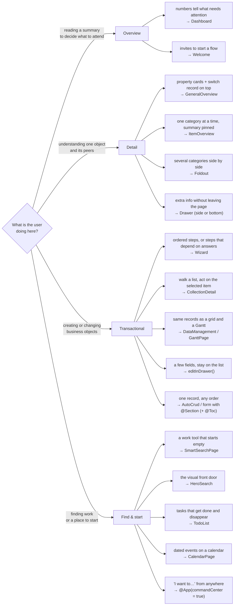

Mateu gives you a **library of full-page templates** (archetypes). This page is the decision guide
that picks the right one, the way an enterprise design system teaches you to: start from the
*user's goal*, narrow by *data density*, land on a *template*. The taxonomy follows the Oracle
Redwood page templates — the clearest public reference for this — expressed once in Mateu and
rendered by every design system.

**This choice is the normal starting point of building a UI**, not an afterthought: list the
screens your app needs, then run each one through this guide. Picking the template per screen is a
decision you make — Mateu infers the template itself only in two specific cases (see
[the last section](#what-mateu-can-infer--and-what-it-cant)); everything below the template
(layout, widgets, sections) is where inference does the heavy lifting.

For the catalog (template → Mateu piece → demo route) see [Page templates](/ux-patterns/page-templates/). This
page is the *how do I pick one*. For each of the six page types with its anatomy and a minimal YAML and
code example, see [Page types](/ux/page-types/).

## The decision tree at a glance

One question picks the family: **what is the user doing on this screen?** Inside a family, take
the first condition that holds, top to bottom.

Two tie-breakers settle most screens that fit two branches:

- **The main task wins.** A customer record the user edits now and then is a *Detail* page with an
  Edit action, not a *Transactional* one.
- **A panel only if nobody needs a link to it.** Before choosing a drawer (`Drawer`,
  `editInDrawer()`, a wizard in a drawer), check the user will never share it, bookmark it or come
  back to it with the browser's Back button. If they will, it is a page.

## Step 1 — Category, from the user's goal

Every page answers one of three goals. Ask what the user is fundamentally doing:

| Category | The user is… | Read | Create / Edit |
|---|---|---|---|
| **Overview** | getting a high-level, summarized picture to plan next steps | ✅ | ❌ |
| **Detail** | exploring one entity in depth, moving laterally across peers | ✅ | ❌ |
| **Transactional** | creating or updating one or more business objects | ❌ | ✅ |

If the user only **reads aggregated** information → Overview. If they **read one thing** in depth
→ Detail. If they **change** things → Transactional.

## Step 2 — Data density, from the content

Every template is sized with one of three widths — Mateu's `@PageWidth` / `PageWidthSupplier`
([page width](/ux-patterns/page-templates/)):

| Width | Use for | Mateu |
|---|---|---|
| **Fixed** | text-heavy pages that don't benefit from extra width (too-wide text is harder to read) | `@PageWidth(FIXED)` |
| **Full width** | high-density data — grids, tables, Gantt charts — that should fill the viewport | `@PageWidth(FULL_WIDTH)` |
| **Edge to edge** | canvases with multiple panels or drawers, no margins | `@PageWidth(EDGE_TO_EDGE)` |

When you don't set it, Mateu infers it from the content (full-bleed canvases → edge-to-edge, dense
datagrids → full width, everything else → fixed). Set it explicitly only when the inference is
wrong for your case.

## Step 3 — Template, from the shape of your data

### Collection pages (many records)

| You need… | Template | Mateu |
|---|---|---|
| Full CRUD of one entity (list + create/edit/view/delete) | **Create & Edit (simple)** | [`AutoCrud<T>`](/ux-patterns/create-and-edit/) |
| A listing that grows à la carte — search, filters, detail, edit, create, delete as needed | **Smart Filter and Search** | [`Listing<Row>` + capability interfaces](/java-user-manual/build/capability-listings/) |
| A standalone search-first page (typed facets, starts empty) | **Smart Search page** | [`SmartSearchPage<Filters, Row>`](/ux-patterns/smart-search/) |
| A hero banner over a faceted search (landing + collection) | — | [`HeroSearch<Filters, Row>`](/ux-patterns/hero-search/) |
| Pending work as counted buckets of actionable cards | **To-do list** | [`TodoList<Row>`](/ux-patterns/to-do-list/) |
| A month grid with event actions | **Calendar** | [`CalendarPage`](/ux-patterns/calendar/) |
| A searchable list with an in-place detail pane | **Collection Detail** | [`CollectionDetail<Row>`](/ux-patterns/collection-detail/) |

### Overview pages

| You need… | Template | Mateu |
|---|---|---|
| A prioritized snapshot: KPIs + charts to start the day | **Dashboard Landing** | [`Dashboard`](/ux-patterns/dashboard/) |
| A visually engaging entry point into a workflow, with CTAs | **Welcome** | [`Welcome`](/ux-patterns/welcome-page/) + `@WelcomeBanner` |

### Detail pages (one entity)

| You need… | Template | Mateu |
|---|---|---|
| An overview across the top + several categories in lateral panels | **Foldout** | [`Foldout`](/ux-patterns/foldout/) |
| The simplest detail page: context strip over property cards, with a record switcher | **General Overview** | [`GeneralOverview<Row>`](/ux-patterns/general-overview/) |
| A sticky key-info panel + tabbed detail for one item | **Item Overview** | [`ItemOverview`](/ux-patterns/item-overview/) |
| Extra read-only info about an object *without leaving the page* (side panel) | **General Drawer** | [`Drawer`](/ux-patterns/drawer/#general-drawer--read-only-detail-subtitle-sizes-maximize-peer-navigation) (subtitle/size/maximizable/peer-nav) |
| The same, docked at the bottom (expand/collapse) | **Bottom Drawer** | [`Drawer`](/ux-patterns/drawer/#bottom-drawer-drawerpositionbottom--collapsible) (`DrawerPosition.bottom` + `collapsible`) |

### Transactional pages (create / edit)

| You need… | Template | Mateu |
|---|---|---|
| Create/edit a record — validation, optimistic locking, dirty guard | **Create & Edit (simple)** | [`AutoCrud<T>`](/ux-patterns/create-and-edit/) |
| The same for a complex object: section index + a contextual detail panel | **Advanced Create & Edit** | [`@Toc`](/ux-patterns/sections-index/) (anchor nav) *or* [`@Aside`](/ux-patterns/layout-inference/#aside--a-content-page-from-a-plain-form) (detail slot) + `@KPI`/`@Timestamp`/peer-nav — see [Advanced create & edit](/ux-patterns/advanced-create-and-edit/) |
| Create/edit in a panel that slides over the listing (which never unmounts) | **Create & Edit Drawer** | [`editInDrawer()`](/ux-patterns/drawer/#crud-editing-in-a-drawer-editindrawer) |
| A list with an in-place detail pane and actions on the selected item | **Collection Detail** | [`CollectionDetail<Row>`](/ux-patterns/collection-detail/) |
| A multi-step process, 2–25 steps, with a lateral progress rail | **Guided Process** | [`Wizard`](/ux-patterns/wizard/) + `@WizardProgress(RAIL)` |
| A short sub-flow or batch action inside a drawer (≤5 steps) | **Guided Process Drawer** | [`Drawer`](/ux-patterns/drawer/) + `EmbeddedView(wizard)` (drawn as a generic wizard in the drawer) |
| A dense datagrid you edit in place, optionally switching to a Gantt | **Data Management** | [`DataManagement`](/ux-patterns/data-management/) (grid ⇄ Gantt switch) |
| A scheduling canvas: Gantt + docked detail panel | **Gantt page** | [`GanttPage`](/ux-patterns/gantt/#gantt-page-template-ganttpage-archetype) |

Every template in the tables above is available today — each links to its archetype, annotation or
composition.

## Close calls

When two templates both seem to fit, one question usually decides:

| Torn between | The question that decides |
|---|---|
| GeneralOverview · ItemOverview · Foldout | Are a few property cards and a record switcher enough? → **GeneralOverview**. Does the user read one category at a time with the summary always in view? → **ItemOverview**. Must they see several categories at once, side by side? → **Foldout** |
| Drawer · page | Does the user go straight back to what was underneath? → **Drawer**. Do they share it, bookmark it or return with Back? → **page** |
| CollectionDetail · listing with `Navigable` | Does the user walk the items one after another, reading each detail? → **CollectionDetail**. Do they look for one item and open it? → **`Listing` + `Navigable`** (the selection of a CollectionDetail is not in the URL) |
| Dashboard · Welcome | Does the screen tell, with numbers, what needs attention? → **Dashboard**. Does it invite the user to start something? → **Welcome** |
| TodoList · listing | Is each row a task that gets done and leaves the list? → **TodoList**. Are they records that stay? → **listing** |
| `editInDrawer()` · edit page | A few fields while the user keeps working on the list? → **`editInDrawer()`**. Several sections, or a link needed? → **page** (with `@Toc` past four sections) |
| Wizard · form with sections | Is there a mandatory order, or steps that depend on earlier answers? → **Wizard**. Can it be filled in any order? → **form with `@Section`** |
| DataManagement · `@InlineEditing` | Does the user also need the same data as a Gantt? → **DataManagement**. Otherwise → a listing with **`@InlineEditing`** |
| SmartSearchPage · HeroSearch | Is it a work tool? → **SmartSearchPage**. Is it the visual front door into the app? → **HeroSearch** |

## How the choice is encoded

- **Category** → the `pageType` on the wire (`landing`/`collection`/`detail`/`form`/`process`/
  `dashboard`). Archetypes declare theirs; set it explicitly with `@PageTemplate(PageType.X)`, or
  with `pageType:` on a YAML page definition.
- **Density** → `@PageWidth(FIXED | FULL_WIDTH | EDGE_TO_EDGE)`, or leave it inferred.
- **Template** → extend the archetype (or set the flag) from Step 3. Everything below is
  composition of wire components that already render on every renderer — except where the
  Redwood column of [Page templates](/ux-patterns/page-templates/) says otherwise.

## What goes in the page header

Once the template is chosen, every piece of data has a place. The rule behind almost every case:
what the user must keep in sight while working goes **up and pinned**; what they read at leisure
goes to the **body**; supporting material goes to a **side panel** or a **drawer**. For the header:

| If the data… | It goes to | Mateu |
|---|---|---|
| identifies the object, or says what the page is for | Title (required) | `@Title` / `TitleSupplier`; while creating, `@TitlePlaceholder` |
| situates the object (area, collection, parent) | Overline | `@Overline` / `OverlineSupplier` |
| adds a line of context | Subtitle | `@Subtitle` / `SubtitleSupplier` |
| is a lifecycle state (Draft, Approved, Blocked) | One badge, neutral unless it asks for action | `@BadgeInHeader` on the field / `HeaderBadgesSupplier` |
| must stay in view while the user works below (customer, balance, dates, amount) | Contextual info, at most four, labelled when the value alone is ambiguous | `@KPI` on the field |
| says when it was last saved | Timestamp — required whenever there is a Save action | `@Timestamp("Last updated")` on the field |
| identifies a person or organisation | Avatar — never decorative | `@Avatar` on the field / `AvatarSupplier` |
| leads to a sibling object of the same shape | Previous / next | `PeerNavigationSupplier` |
| picks another object without going back to the list | Record switcher | `RecordSwitcherSupplier` |
| anything else | Body | fields and `@Section` |

Fields that go up to the header (`@BadgeInHeader`, `@KPI`, `@Timestamp`) leave the body on their
own. For actions: **one** primary action with a concrete verb (Create, Send, Publish rather than
Submit), a Cancel that warns about unsaved changes (`cancel*`/`back` actions do so automatically),
and secondary actions after them.

Each template page lists what goes in **its own regions** (the key-info panel of an item overview,
the panels of a foldout, the KPI band of a dashboard…) under *Anatomy* — see the links in Step 3.

You are never forced onto a template: a plain `@UI` class with declared fields still infers a valid
layout ([layout inference](/ux-patterns/layout-inference/)). The templates are opinionated rails on top, not a
requirement.

## What Mateu can infer — and what it can't

Be clear about the division of labor. **Choosing the template is your decision** — that's this
guide, and it's the normal path, not a failure of the framework. What Mateu infers:

- **Below the template, a lot.** Field types → widgets, field count/weight → columns and sections,
  read-only shape → tabs, and so on ([layout inference](/ux-patterns/layout-inference/)). This is
  why an archetype with a nearly-empty body already renders well.
- **The template itself, in exactly two cases.** A class whose shape is fully derivable composes
  its template with no archetype: consecutive `MetricCard` fields → a **Dashboard**; only `Button`
  fields + `@Panel` tiles → a **Welcome** landing (`@AutoPage(false)` opts out).
- **A hint, for a few more.** When a plain form structurally resembles an archetype (a selectable
  list next to a detail pane → CollectionDetail), the advisor logs a one-time suggestion — but it
  doesn't compose it; you decide.
- **Convenience shortcuts are still explicit choices.** `@Aside` (one field → contextual side
  panel of a content-page) or `@Toc` (section index) are annotations you add — tiny decisions, but
  yours.

Everything above is the same uniform slot grammar the archetypes themselves compose.

## Status

The full Redwood page-template catalog is covered — the Overview, Detail and Transactional
families, the drawers (General, Bottom, Create&Edit, Guided Process), the dense canvases (Data
Management, Gantt page) and the composed **Advanced Create & Edit** — plus the extras Redwood
doesn't name. All of it is the same uniform slot grammar (a canonical page header + `ContentLayout`
main/aside/footer), so every template renders on Vaadin and the native renderers and has
.NET/Python parity; on Redwood, check the template's row in [Page templates](/ux-patterns/page-templates/).

What's left is polish, not coverage: deeper variants (a bottom + side drawer used *simultaneously*
on the Gantt page, batch flows in the Guided Process Drawer) and closing the Figma design-to-code
loop for the newest kinds.
