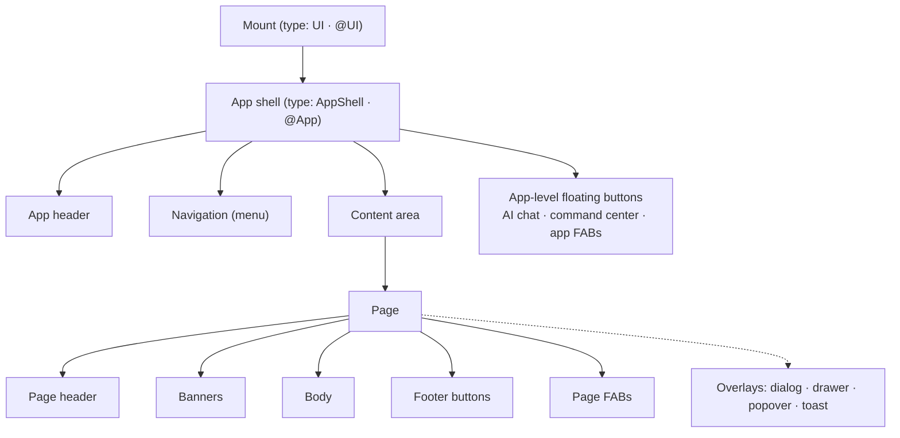

import { Tabs, TabItem } from '@astrojs/starlight/components';

Every Mateu app has the same nested structure. Knowing it tells you where any piece of UI lives,
which declaration controls it, and why it looks consistent on every renderer.



## The anatomy, labelled

This is the canonical arrangement on a wide web viewport with the menu on top. Other variants move
the navigation (see [shell variants](#the-app-shell-and-its-variants)), and the native renderers
adapt it to their platform (a drawer on a phone, tool windows in IntelliJ), but the parts are the
same.

```text
┌──────────────────────────────────────────────────────────────────────────────────────┐
│ [1] Logo · Title   [2] Products  Orders ▾  Reports      [3] Hotel ▾  Actions ▾  🔔  ☾  │  ← app header
├──────────────────────────────────────────────────────────────────────────────────────┤
│  [4] Home › Orders                                                                    │
│  [5] SALES                                              [9] ‹ ›   [10] Edit  Export … │
│  [6] Order SO-1042   [7] Open  Priority                                               │  ← page header
│      Placed by ACME Corp · Last updated 2 min ago        [8] Total 1,240 €  Lines 12  │
├──────────────────────────────────────────────────────────────────────────────────────┤
│  [11] ⚠ Payment pending: the customer has not paid the deposit yet.            ✕     │  ← banners
├──────────────────────────────────────────────────────────────────────────────────────┤
│  [12] ┌ Customer ───────────────┐  ┌ Shipping ────────────────┐                        │
│       │ Name   ACME Corp        │  │ Address  …               │                        │  ← body
│       └─────────────────────────┘  └──────────────────────────┘                        │
│       ┌ Lines ───────────────────────────────────────────────┐                        │
│       │ Product        Qty   Price                            │                        │
│       └──────────────────────────────────────────────────────┘                        │
├──────────────────────────────────────────────────────────────────────────────────────┤
│                                                        [13] Cancel   Save             │  ← footer buttons
│                                                                         [14] (+)  (✦) │  ← FABs
└──────────────────────────────────────────────────────────────────────────────────────┘
          [15] overlays open above all of this: dialog · drawer · popover · toast
```

| # | Part | What it is | Declared with |
|---|---|---|---|
| 1 | App identity | Title, subtitle, logo, favicon | `title:` / `logo:` on `type: AppShell` · `@Title`, `@Logo`, `@FavIcon` on the `@UI` class |
| 2 | Navigation | The menu, drawn by the shell variant | `menu:` · `@Menu` fields, `MenuSupplier` |
| 3 | Header widgets | Context pickers, header actions, notification bell, theme toggle, live values | see [the app header](#the-app-header) |
| 4 | Breadcrumbs | Where the page sits | `BreadcrumbsSupplier` · [breadcrumbs](/java-user-manual/advanced/breadcrumbs/) |
| 5 | Overline | A quiet line above the title | `@Overline` / `OverlineSupplier` |
| 6 | Title | The page title (and a placeholder while it is empty) | `title:` · `@Title` / `TitleSupplier`, `@TitlePlaceholder` |
| 7 | Badges | Status chips beside the title | `@BadgeInHeader` fields / `BadgeSupplier` |
| 8 | Subtitle, timestamp, KPIs | Context under the title; key/value facts | `subtitle:` · `@Subtitle`, `@Timestamp`, `@KPI` fields |
| 9 | Peer navigation, record switcher | Previous / next record; jump to any record | `PeerNavigationSupplier`, `RecordSwitcherSupplier` |
| 10 | Toolbar | The page's actions; secondary ones collapse into "…" | `toolbar:` · `@Toolbar` methods, `ToolbarSupplier` |
| 11 | Banners | Messages above the body: info, success, warning, danger | `@Banner` / `BannerSupplier`, or returned by an action |
| 12 | Body | The components of the page: sections, zones, tabs, listings… | `content:` · the view model's fields, or a component tree |
| 13 | Footer buttons | The page's closing actions | `buttons:` · `@Button` methods, `ButtonsSupplier` |
| 14 | FABs | Floating action buttons, per page or for the whole app | `@Fab` methods |
| 15 | Overlays | Dialogs, drawers, popovers, toasts | returned by actions; see [overlays](#overlays) |

The page-header parts 5–9 and the banners are page **metadata**, declared in code today; a YAML
`Form` or `Listing` has `title`, `subtitle`, `toolbar`, `header`, `buttons` and `footer`. The
header grammar itself (one primary action, secondary actions in "…", a leading `EntityHeader`
hoisted into the header) is described in [page templates](/ux-patterns/page-templates/).

## The mount

A **mount** is an app served at a base path (`/`, `/back-office`). It names its home page and the
route files that make it up. Several mounts can live in one project, or be
[federated](/mateu-about/ui-federation/) into one console. A mount has no visual presence of its own:
what you see is its shell. See [mounts and routes](/concepts/routes-and-mounts/).

## The app shell and its variants

The **app shell** is the chrome around every page of a mount: identity, header, navigation and
the content area. It is not a page: its content area shows the current route's page.

The **variant** decides how navigation is drawn:

| Variant | What it looks like | Good for |
|---|---|---|
| `MENU_ON_TOP` | a horizontal bar; groups open as dropdowns | a standard back office with two levels |
| `HAMBURGER_MENU` | a button opening the whole menu in a drawer | many top-level entries; small screens |
| `HAMBURGER_SECTIONS` | the hamburger holds the sections, a band under the header holds the current section's entries | large suites organised in sections |
| `MENU_ON_LEFT` | a persistent, collapsible sidebar | keeping the whole tree visible while working |
| `RAIL` | a compact icon rail on the left | frequent switching between a few areas |
| `TABS` | a tab bar | a few peer sections with no hierarchy |
| `TILES` | flat top-level entries; an entry with children opens a hub of tiles | deep menus |
| `AUTO` (the default) | chosen from the menu's shape, see below | not deciding |

How `AUTO` picks, in order:

1. the menu federates a `RemoteMenu` → `MENU_ON_TOP`;
2. a group contains another group (three levels or more) → `TILES`;
3. the menu has groups and more than seven top-level entries → `HAMBURGER_MENU`;
4. the menu has groups → `MENU_ON_TOP`;
5. the menu has no groups at all, however long → `TABS`.

An explicit variant always wins. (`MEDIATOR` is internal: the chrome-less shell a CRUD
uses inside the content area.)

Two shell flags change the chrome itself:

- **Command center** (`commandCenter: true` · `@App(commandCenter = true)`): a floating button that
  opens a full-screen palette unifying navigation, entity search, recent screens and the AI
  hand-off. See [command center](/ux-patterns/command-center/).
- **Chromeless** (`chromeless: true` · `@App(chromeless = true)`): drops the navigation chrome
  entirely; the command center becomes the way around. Implies the command center.

The content area can also be split in two panes (`@App(layout = AppLayout.SPLIT)`), and the
`accentColor`/`accentStrip` attributes brand the shell (see
[accent colour and strip](/design-systems/accent-strip/)).

<Tabs syncKey="authoring">
<TabItem label="YAML">

```yaml
# specs/ui/app.yaml, bound to the mount root ("") in routes.yaml
type: AppShell
title: Catalogue
variant: AUTO
themeToggle: true
commandCenter: true
menu:
  - {type: RouteLink, label: Products, route: products}
  - type: Menu
    label: Reports
    submenu:
      - {type: RouteLink, label: Sales, route: reports/sales}
```

</TabItem>
<TabItem label="Java">

```java
@UI("")
@Title("Catalogue")
@App(value = AppVariant.AUTO, themeToggle = true, commandCenter = true)
public class Catalogue {
  @Menu Products products;
  @Menu Reports reports;      // a class holding @Menu fields becomes a group
}
```

C#: `[App(...)]` with `[MenuItem]` methods. Python: `@app(...)` with `@menu_item`.

</TabItem>
</Tabs>

More: [App shell and menus](/concepts/app-shell-and-menus/) (the concept),
[App shell as data](/define/yaml/app-shell/) (every YAML key),
[`@App`](/java-ui-definition/annotations/app/) (every attribute) and
[navigation patterns](/ux-patterns/navigation/) (each variant in detail).

## The app header

The right side of the app header hosts app-wide widgets. Each one appears only when the app
declares it:

| Widget | What it does | Declared with | Pattern page |
|---|---|---|---|
| Context pickers | Fix a value for every screen: active hotel, company, fiscal year | `@AppContext` field on the app class | [App context](/ux-patterns/app-context/) |
| Header actions | Buttons and dropdowns next to the pickers | `AppActionsSupplier` | [App context › header actions](/ux-patterns/app-context/) |
| Notification bell | Inbox with unread count and mark-as-read | `NotificationsSupplier` | [Notification inbox](/ux-patterns/notification-inbox/) |
| Global search | ⌘K palette searching the menu *and* your data | `GlobalSearchSupplier` | [Global search](/ux-patterns/global-search/) |
| Theme toggle | Light / dark (Redwood: light only, ignored) | `themeToggle` | [`@App`](/java-ui-definition/annotations/app/) |
| Live header values | Values pushed from the server (a counter, a clock) | `headerValues:` · `HeaderValuesSupplier` | [Live header values](/ux-patterns/live-header-values/) |
| Widgets | Any component (a version tag, a status badge) | `widgets:` | [App shell as data](/define/yaml/app-shell/) |
| Open on mobile | A QR code that opens the current screen in the Mateu app | `mobileQr` | [Open on mobile](/ux-patterns/mobile-app/) |

App-wide behaviours that are not widgets: [app shortcuts and quick launch](/ux-patterns/app-shortcuts/)
(`@AppShortcut`, `shortcuts:`), [access keys](/ux-patterns/keyboard-shortcuts/) (`accessKeys`),
the [idle-session warning](/ux-patterns/idle-session/) and the
[embedded AI chat](/ai/) (`@AI`, a floating button at the bottom right).

## Navigation and menus

A menu is a list of entries. Every **leaf** either routes somewhere or runs something:

| Entry | What a click does |
|---|---|
| `RouteLink` | navigates to a route of the mount (or a full URL) |
| `RuleLink` | runs an action instead of navigating |
| `Menu` | a group of entries, nestable |
| `RemoteMenu` | the menu of another Mateu service, fetched at runtime |

Two presentations change how a group opens:

- **Card menus** (`@Menu(display = MenuDisplay.cards)`, or `presentation: {display: cards}`): the
  group opens as a panel of cards, each with a description and an image or icon. See
  [card menus](/java-user-manual/build/navigation-and-menus/#card-menus-a-group-that-opens-as-cards).
- **Remote menus**: a shell composes the menus of independent services, so several teams' UIs
  appear as one console. See [shell and remote menus](/mateu-about/shell-and-remote-menus/).

Entries the caller may not open are not sent at all (a `RouteLink` inherits its route's access
rules). The home page is the shell's `homeRoute`, else the mount's `home:`, else the first navigable
entry. More: [navigation and menus](/java-user-manual/build/navigation-and-menus/).

## The content area

The content area shows the page of the current route. Navigating replaces it; the shell stays.
Its width follows the page, not the shell: each page is **fixed** (capped at 1408 px and centred),
**full width** (fluid with side gutters) or **edge to edge** (no margins). See
[page width](/ux/page-types/#page-width).

Inside a page, parts of the screen can be independent **islands**: an embedded view or
[micro-frontend](/java-ui-definition/components/micro-frontend/) with its own state and actions,
which re-renders on its own. See [component communication](/ux-patterns/component-communication/).

## Page anatomy

A page has five regions. Most pages use some of them; a [page type](/ux/page-types/) is largely a
convention about which regions it fills and how.

1. **Header**: breadcrumbs, overline, title, badges, subtitle, timestamp, KPIs, peer navigation,
   record switcher and toolbar. A page can also open with a
   [welcome banner](/ux-patterns/welcome-page/) (`@WelcomeBanner`), a hero above the content.
   When a page's content starts with an [`EntityHeader`](/ux-patterns/entity-header/), the
   renderer hoists it into this header.
2. **Banners**: page messages between the header and the body, static (`@Banner`,
   `BannerSupplier`) or returned by an action (`PageBanner`), optionally closeable or timed. For a
   message *inside* the body, use a [notice](/ux-patterns/notice/).
3. **Body**: the components. In code, fields group into `@Section` cards, which can sit side by side
   in `@Zones`, become `@Tab`s, sit side by side with `@FoldedLayout`, get a sticky index with
   [`@Toc`](/ux-patterns/sections-index/), or place one panel aside with `@Aside`. A
   `ContentLayout` gives the *main + aside + footer* grammar to any page.
4. **Footer buttons**: the closing actions (`@Button` methods, `buttons:` in YAML).
5. **FABs**: floating action buttons (`@Fab`), scoped to the page or, on the app class, to the
   whole app. They stack above the AI and command-center buttons.


Two modifiers change the whole page: [`@Compact`](/ux-patterns/high-density/) for dense
operational screens, and [`@AutoSave`](/ux-patterns/autosave/) for screens without a save
button.

## Overlays

An overlay opens above the page without leaving it. An action returns it, and
`UICommand.closeModal()` closes the topmost one (optionally emitting an event the page reacts to).

| Overlay | Use it for | Pattern page |
|---|---|---|
| `Dialog` | a short, focused interaction that must be answered | [Dialog](/java-ui-definition/components/dialog/) |
| `ConfirmDialog` | confirming a destructive action (`@Action(confirmationRequired = true)` builds one for you) | [Confirm dialog](/java-ui-definition/components/confirm-dialog/) |
| `Drawer` (side) | editing or reading more about something without losing the page; CRUD create/edit with `editInDrawer()` | [Drawer](/ux-patterns/drawer/) |
| `Drawer` (bottom) | a docked, collapsible panel under a canvas | [Bottom drawer](/ux-patterns/drawer/) |
| `Popover` | details on hover or click | [Hover details](/ux-patterns/hover-details/) |
| `ActionPanel` | a categorised "I want to…" menu of actions | [Action panel](/ux-patterns/action-panel/) |
| Toasts | messages returned by actions, including undoable ones | [Undo](/ux-patterns/undo/) |

Overlays trap focus and give it back when they close; see [accessibility](/ux-patterns/accessibility/).

## Next

- [Page types](/ux/page-types/): what fills the content area.
- [Components](/ux/components/): the catalogue every region is built from.
