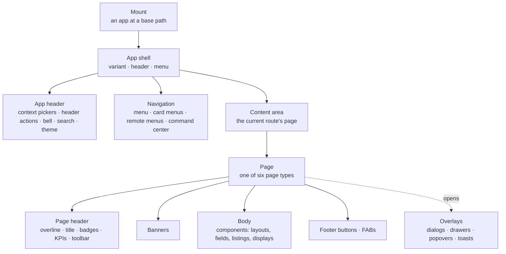

import { Card, CardGrid } from '@astrojs/starlight/components';

You declare a Mateu UI **once**, without naming a design system: as YAML (by hand or in the
[visual editor](/define/yaml/visual-editor/)) or as code in Java, C# or Python. Mateu renders that
one declaration on the web with [Vaadin](/design-systems/vaadin/) or
[Redwood](/design-systems/oracle-redwood/), on phones with the [Mateu app](/native/react-native/)
and on the desktop in [IntelliJ](/native/), whether a backend serves it or it ships as a
[static bundle](/deploy/static-bundle/).

So "the UX" of a Mateu app is not something each screen invents. It is a **grammar** that every
screen follows and every renderer paints. This guide explains that grammar from the outside in.
[What a Mateu UI is made of](/concepts/building-blocks/) maps the *building blocks* (mount, routes,
pages, actions, sources…); this guide is what those blocks look like to the person using the app.

## The grammar in one picture

## Read it top-down

<CardGrid>
  <Card title="1. Structure of an app" icon="laptop">
    The shell and its variants, the app header, navigation and menus, the content area, overlays,
    and the anatomy every page shares (header, banners, body, footer, FABs).
    [Structure of an app →](/ux/app-structure/)
  </Card>
  <Card title="2. Page types" icon="document">
    Every page is one of six types: **collection**, **detail**, **form**, **process**,
    **dashboard** or **landing**. Each type, its templates, its anatomy and a minimal example.
    [Page types →](/ux/page-types/)
  </Card>
  <Card title="3. Components" icon="puzzle">
    The catalogue, by role: layouts, fields, displays, collections, navigation, feedback,
    overlays and specialised canvases, plus field types and how renderers map them.
    [Components →](/ux/components/)
  </Card>
  <Card title="4. Extending it" icon="setting">
    A ladder from least to most effort: semantic annotations, field types, custom components,
    adapters, micro-frontends, design systems and your own renderer.
    [Extending the UI →](/ux/extending/)
  </Card>
  <Card title="5. How quality is kept" icon="approve-check">
    The principles, how they are checked, accessibility on every renderer, and behaviour on
    slow networks. [UX quality →](/ux/quality/)
  </Card>
</CardGrid>

## Three ideas behind every page

**The model says *what*, the renderer says *how*.** A page declares that it has a title, a
listing with a status column and a primary *New* button. It never says "a `vaadin-grid`" or "an
`oj-table`". That is why the same declaration looks native in Vaadin, Redwood, React Native and
IntelliJ, and why a renderer cannot add UI the model did not ask for (see
[the authoring rule](/authoring-rule/)).

**You choose the page type, Mateu fills in below it.** Listing the screens your app needs and
picking a type for each is the design step, and it is yours. Below that choice, Mateu infers a
lot: widgets from field types, columns and sections from the amount of data, tabs for long
read-only records ([layout inference](/ux-patterns/layout-inference/)). Explicit declarations always
win over inference.

**Patterns are a library, not a syllabus.** The [pattern catalogue](/ux-patterns/) documents
more than ninety patterns (smart search, drawers, kanban, Gantt, undo, optimistic locking…). You
do not need to read it. When you need "totals under a grid" or "a side panel that doesn't lose the
page", the pattern page names the one annotation, key or archetype that does it.

## The same page, two renderers

The same form, declared once, painted by the Vaadin renderer and by the Redwood renderer:

## Where to go from here

- **Designing a new app**: list your screens, then read [page types](/ux/page-types/) and run each
  screen through [choosing a page template](/ux-patterns/choosing-a-page-template/).
- **Looking for one specific behaviour**: the [pattern catalogue](/ux-patterns/), grouped by role in
  the sidebar.
- **Building it**: [The Mateu Way](/the-mateu-way/) for code, [pages in YAML](/define/yaml/pages/) for
  data.
