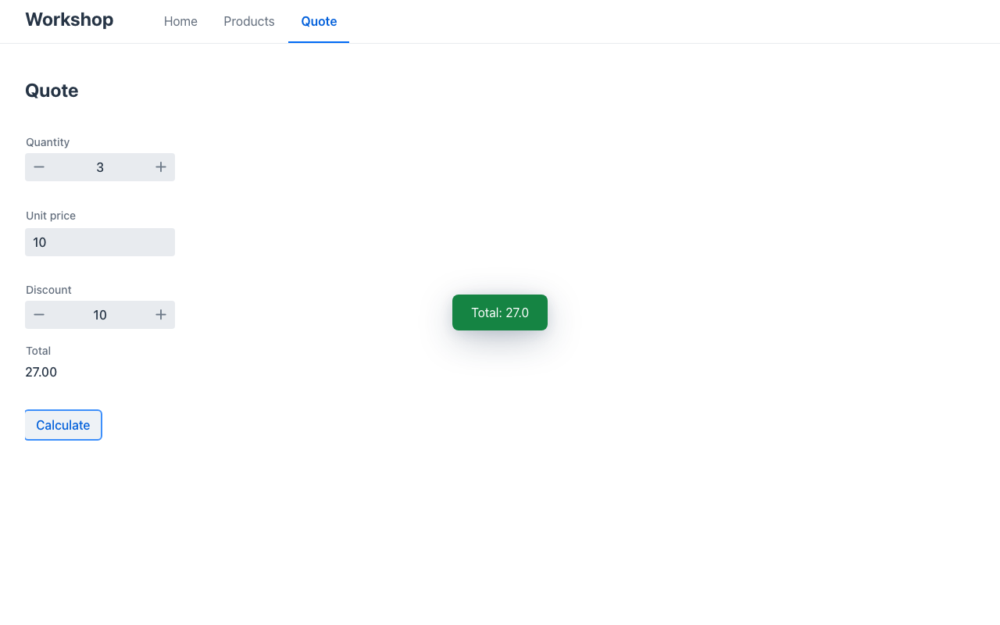

# Lab 01 · Tu primera app (35′)

*[English](guide.md)* · Itinerarios: **Java**, **C#**, **Python** · Inicio: `java|dotnet|python/start` · Solución: `java|dotnet|python/solution`

Generas una app Mateu, la arrancas y la cambias dos veces: un campo nuevo en un registro y una
pantalla nueva. No escribes ni una línea de frontend: de eso se trata.

## 1. Genera el proyecto (5′)

Usa el asistente de tu IDE; aplica el mismo generador que todo lo demás en este taller:

- **IntelliJ**: *File › New › Project… › Mateu*
- **VS Code**: paleta de comandos › *Mateu: New Project…*

Elige: autoría **Code**, runtime **Spring Boot (MVC)** / **.NET** / **Python**, renderer **Vaadin**,
plantilla **Back office: Product CRUD**, artifact **`workshop`**, paquete `com.example.workshop`.

Solo Java, sin IDE:
`mvn archetype:generate -DarchetypeGroupId=io.mateu -DarchetypeArtifactId=mateu-archetype -DarchetypeVersion=3.0-beta.64 -DgroupId=com.example -DartifactId=workshop -Dpackage=com.example.workshop`

> **¿Sin tiempo o sin plugin?** Abre `labs/01-first-app/<tu itinerario>/start/`: es exactamente lo
> que genera el asistente. (Los asistentes escriben la última versión de Mateu; los labs están
> verificados con 3.0-beta.64, que es la que fija `start/`. Si algo no cuadra, sigue desde `start/`.)

Échale un vistazo: es pequeño.

| | Java | C# | Python |
|---|---|---|---|
| Shell de la app (título + menú) | `Shell.java` | `Shell.cs` | `views.py` › `Shell` |
| Página de inicio | `Home.java` | `Home.cs` | `views.py` › `Home` |
| El modelo | `Product.java` | `Products.cs` › `Product` | `views.py` › `Product` |
| El CRUD | `Products.java` + `ProductStore.java` | `Products.cs` › `Products` | `views.py` › `Products` |
| Notas para asistentes de IA | `AGENTS.md`, `CLAUDE.md` | igual | igual |

## 2. Arráncala (5′)

| Itinerario | Desde la carpeta del proyecto | Abre |
|---|---|---|
| Java | `mvn spring-boot:run` | http://localhost:8080 |
| C# | `MATEU_UI=<workshop>/renderers/mateu-vaadin.jar dotnet run` | http://localhost:8080 |
| Python | `MATEU_UI=<workshop>/renderers/mateu-vaadin.jar uvicorn main:app --port 8080` (dentro de tu `.venv`) | http://localhost:8080 |

`<workshop>` es la carpeta `workshop/` del repositorio (desde `labs/01-first-app/dotnet/start` es
`../../../..`). Java recibe el renderer como dependencia Maven (`mateu-vaadin` en el `pom.xml`); C# y
Python sirven el jar al que apunte `MATEU_UI`; sin él solo responden la API.

Navega: **Products** es un CRUD completo: busca, abre una fila, **New**, **Save** con el nombre vacío
(el servidor lo rechaza), **Delete**. Cuenta las líneas que lo hacen: un modelo, una clase.

## 3. Añade un campo (10′)

Un producto necesita su **stock**: un entero, nunca negativo.

**Java** — `Product.java`, entre `price` y `status`:

```java
@Min(0) int stock,
```

y dale un valor a cada ejemplo de `ProductStore.java`: `new Product("P-001", "Espresso machine", 249.0, 12, ProductStatus.Available)`.

**C#** — `Products.cs`, en `Product`:

```csharp
[Range(0, int.MaxValue)] public int Stock { get; set; }
```

(y `Stock = 12` en los ejemplos).

**Python** — `views.py`, en `Product` (importa `Min` de `mateu_ui.uidl`):

```python
stock: Annotated[int, Min(0)] = 0
```

(y pasa el stock a `_product(...)` en los ejemplos).

Reinicia (Java: `Ctrl+C`, `mvn spring-boot:run`; C#/Python igual). Deberías ver una columna
**Stock**, un campo **Stock** en *New*, y *Save* con `-1` rechazado por el servidor.

## 4. Añade una pantalla tuya (15′)

Un **presupuesto** rápido: cantidad × precio unitario − un % de descuento, y un botón **Calculate**.

**Java** — una clase nueva `Quote.java` (sin `@UI`: vive dentro del shell):

```java
@Title("Quote")
public class Quote {

  @Min(1) int quantity = 1;

  @Min(0) @Stereotype(FieldStereotype.money) double unitPrice;

  @Min(0) @Max(100) int discount;

  @ReadOnly @Stereotype(FieldStereotype.money) double total;

  @Button
  public List<Object> calculate() {
    total = Math.round(quantity * unitPrice * (100 - discount)) / 100.0;
    return List.of(new State(this), new Message("Total: " + total));
  }
}
```

y una línea en `Shell.java`: `@Menu Quote quote;`

**C#** — `Quote.cs`:

```csharp
[UI("quote"), Title("Quote")]
public class Quote
{
    [Range(1, int.MaxValue)] public int Quantity { get; set; } = 1;
    [Range(0, double.MaxValue), Money] public double UnitPrice { get; set; }
    [Range(0, 100)] public int Discount { get; set; }
    [ReadOnly, Money] public double Total { get; set; }

    [Button]
    public object[] Calculate()
    {
        Total = Math.Round(Quantity * UnitPrice * (100 - Discount)) / 100.0;
        return [this, new Message($"Total: {Total}")];
    }
}
```

y en `Shell.cs`: `[MenuItem("Quote")] public Quote Quote() => new();`

**Python** — en `views.py` (importa `Max`, `Message`, `Min`, `ReadOnly`, `button`):

```python
@ui("quote")
@title("Quote")
class Quote:
    quantity: Annotated[int, Min(1)] = 1
    unit_price: Annotated[float, Min(0), Money()] = 0.0
    discount: Annotated[int, Min(0), Max(100)] = 0
    total: Annotated[float, ReadOnly(), Money()] = 0.0

    @button
    def calculate(self) -> list:
        self.total = round(self.quantity * self.unit_price * (100 - self.discount)) / 100
        return [self, Message(f"Total: {self.total}")]
```

y en `Shell`: `@menu_item("Quote")` sobre un `def quote(self) -> Quote: return Quote()`.

**¿Por qué devolver la vista *y* un mensaje?** Una acción responde con lo que debe hacer el
navegador. Un `Message` solo muestra un aviso y deja el formulario como estaba: `total` cambiaría
solo en el servidor. Devolver la vista (`State(this)` en Java, `this`/`self` en C#/Python) envía de
vuelta los campos cambiados. (El lab 03 tiene un test que caza justo este error.)



✅ **Checkpoint**: el menú tiene **Quote**; cantidad 3, precio unitario 10, descuento 10 →
**Calculate** muestra **27.00** en Total y un aviso "Total: 27.0". Products muestra la columna Stock.

## Extra (si acabas antes)

- Agrupa los campos del presupuesto: `@Section("Price")` en `unitPrice`/`discount` (C#
  `[Section("Price")]`, Python `Annotated[..., Section("Price")]`).
- Convierte **Calculate** en botón de cabecera: `@Toolbar` en vez de `@Button` (C# `[Toolbar]`,
  Python `@toolbar`).
- Genera un segundo proyecto con otra plantilla de la galería (Java: **Dashboard + listings**,
  **Wizard-driven intake**, **Operations: board + calendar**) y lee sus clases.
- Abre `AGENTS.md`: es lo que tu asistente de IA lee sobre este proyecto.
