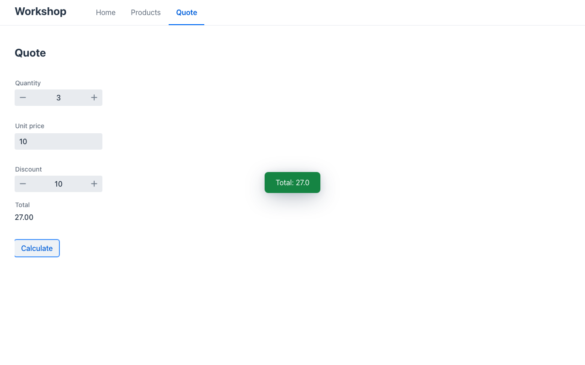

# Lab 01 · Your first app (35′)

*[Español](guide.es.md)* · Tracks: **Java**, **C#**, **Python** · Start: `java|dotnet|python/start` · Solution: `java|dotnet|python/solution`

You generate a Mateu app, run it, and change it twice: a new field on a record and a new screen. You
write no frontend code — that is the whole point.

## 1. Generate the project (5′)

Use the wizard of your IDE; it applies the same generator as everything else in this workshop:

- **IntelliJ**: *File › New › Project… › Mateu*
- **VS Code**: command palette › *Mateu: New Project…*

Choose: authoring **Code**, runtime **Spring Boot (MVC)** / **.NET** / **Python**, renderer **Vaadin**,
template **Back office: Product CRUD**, artifact **`workshop`**, package `com.example.workshop`.

Java only, without an IDE:
`mvn archetype:generate -DarchetypeGroupId=io.mateu -DarchetypeArtifactId=mateu-archetype -DarchetypeVersion=3.0-beta.64 -DgroupId=com.example -DartifactId=workshop -Dpackage=com.example.workshop`

> **Short on time or no plugin?** Open `labs/01-first-app/<your track>/start/`: it is exactly what
> the wizard generates. (The wizards write the newest Mateu release; the labs are verified on
> 3.0-beta.64, which `start/` pins. If anything differs, carry on from `start/`.)

Look around — it is small:

| | Java | C# | Python |
|---|---|---|---|
| App shell (title + menu) | `Shell.java` | `Shell.cs` | `views.py` › `Shell` |
| Home page | `Home.java` | `Home.cs` | `views.py` › `Home` |
| The model | `Product.java` | `Products.cs` › `Product` | `views.py` › `Product` |
| The CRUD | `Products.java` + `ProductStore.java` | `Products.cs` › `Products` | `views.py` › `Products` |
| Notes for AI assistants | `AGENTS.md`, `CLAUDE.md` | same | same |

## 2. Run it (5′)

| Track | From the project folder | Open |
|---|---|---|
| Java | `mvn spring-boot:run` | http://localhost:8080 |
| C# | `MATEU_UI=<workshop>/renderers/mateu-vaadin.jar dotnet run` | http://localhost:8080 |
| Python | `MATEU_UI=<workshop>/renderers/mateu-vaadin.jar uvicorn main:app --port 8080` (inside your `.venv`) | http://localhost:8080 |

`<workshop>` is the `workshop/` folder of the repository (from `labs/01-first-app/dotnet/start` that
is `../../../..`). Java gets the renderer as a Maven dependency (`mateu-vaadin` in `pom.xml`); C# and
Python serve the jar you point `MATEU_UI` at — without it they answer the API only.

Click around: **Products** is a full CRUD — search, open a row, **New**, **Save** with an empty name
(the server refuses it), **Delete**. Count the lines that make it: one model, one class.

## 3. Add a field (10′)

A product needs its **stock**: a whole number, never negative.

**Java** — `Product.java`, between `price` and `status`:

```java
@Min(0) int stock,
```

and give each sample in `ProductStore.java` a value: `new Product("P-001", "Espresso machine", 249.0, 12, ProductStatus.Available)`.

**C#** — `Products.cs`, in `Product`:

```csharp
[Range(0, int.MaxValue)] public int Stock { get; set; }
```

(and `Stock = 12` in the samples).

**Python** — `views.py`, in `Product` (import `Min` from `mateu_ui.uidl`):

```python
stock: Annotated[int, Min(0)] = 0
```

(and pass the stock to `_product(...)` in the samples).

Restart (Java: `Ctrl+C`, `mvn spring-boot:run`; C#/Python the same). You should see a **Stock**
column, a **Stock** input on *New*, and *Save* with `-1` refused by the server.

## 4. Add a screen of your own (15′)

A quick **quote**: quantity × unit price − a discount %, and a **Calculate** button.

**Java** — a new class `Quote.java` (no `@UI`: it lives inside the shell):

```java
@Title("Quote")
public class Quote {

  @Min(1) int quantity = 1;

  @Min(0) @Stereotype(FieldStereotype.money) double unitPrice;

  @Min(0) @Max(100) int discount;

  @ReadOnly @Stereotype(FieldStereotype.money) double total;

  @Button
  public List<Object> calculate() {
    total = Math.round(quantity * unitPrice * (100 - discount)) / 100.0;
    return List.of(new State(this), new Message("Total: " + total));
  }
}
```

and one line in `Shell.java`: `@Menu Quote quote;`

**C#** — `Quote.cs`:

```csharp
[UI("quote"), Title("Quote")]
public class Quote
{
    [Range(1, int.MaxValue)] public int Quantity { get; set; } = 1;
    [Range(0, double.MaxValue), Money] public double UnitPrice { get; set; }
    [Range(0, 100)] public int Discount { get; set; }
    [ReadOnly, Money] public double Total { get; set; }

    [Button]
    public object[] Calculate()
    {
        Total = Math.Round(Quantity * UnitPrice * (100 - Discount)) / 100.0;
        return [this, new Message($"Total: {Total}")];
    }
}
```

and in `Shell.cs`: `[MenuItem("Quote")] public Quote Quote() => new();`

**Python** — in `views.py` (import `Max`, `Message`, `Min`, `ReadOnly`, `button`):

```python
@ui("quote")
@title("Quote")
class Quote:
    quantity: Annotated[int, Min(1)] = 1
    unit_price: Annotated[float, Min(0), Money()] = 0.0
    discount: Annotated[int, Min(0), Max(100)] = 0
    total: Annotated[float, ReadOnly(), Money()] = 0.0

    @button
    def calculate(self) -> list:
        self.total = round(self.quantity * self.unit_price * (100 - self.discount)) / 100
        return [self, Message(f"Total: {self.total}")]
```

and in `Shell`: `@menu_item("Quote")` on a `def quote(self) -> Quote: return Quote()`.

**Why return the view *and* a message?** An action answers with what the browser should do. A
`Message` alone shows a toast and leaves the form as it was — `total` would change on the server
only. Returning the view (`State(this)` in Java, `this`/`self` in C#/Python) sends the changed fields
back. (Lab 03 has a test that catches exactly this mistake.)



✅ **Checkpoint**: the menu has **Quote**; quantity 3, unit price 10, discount 10 → **Calculate**
shows **27.00** in Total and a "Total: 27.0" toast. Products shows a Stock column.

## Stretch (if you finish early)

- Group the quote's fields: `@Section("Price")` on `unitPrice`/`discount` (C# `[Section("Price")]`,
  Python `Annotated[..., Section("Price")]`).
- Make **Calculate** a header button: `@Toolbar` instead of `@Button` (C# `[Toolbar]`, Python `@toolbar`).
- Generate a second project from another template of the gallery (Java: **Dashboard + listings**,
  **Wizard-driven intake**, **Operations: board + calendar**) and read its classes.
- Open `AGENTS.md`: it is what your AI assistant reads about this project.
