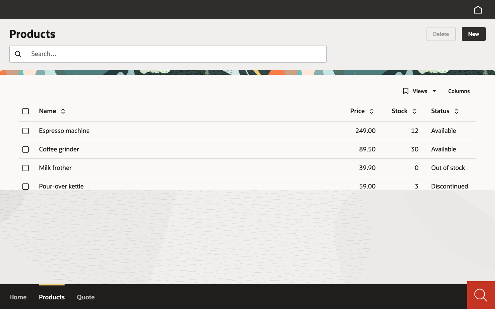

# Lab 02 · Una UI, todos los renderers (30′)

*[English](guide.md)* · Itinerarios: todos · Código: Java `java/start` → `java/solution`; C# y Python siguen con la solución del lab 01

Tu app dice **qué** hay en pantalla, nunca **cómo** dibujarlo. La misma respuesta del servidor la
dibujan Vaadin, Oracle Redwood, el móvil (nativo) y una app de escritorio. En este lab lo ves cuatro
veces.

## 1. La misma app en Oracle Redwood (10′)

**Java** — el renderer es una dependencia. En el `pom.xml` cambia

```xml
<artifactId>mateu-vaadin</artifactId>
```

por

```xml
<artifactId>mateu-redwood</artifactId>
```

y reinicia (`mvn spring-boot:run`). La solución añade además
`src/main/resources/specs/ui/project.yaml` con `renderer: redwood`, que le dice a las herramientas del
IDE (editor visual, previsualizaciones) qué aspecto usar; a la app en marcha solo le importa la
dependencia.

**C# / Python** — ningún cambio de código: apunta `MATEU_UI` al otro jar y reinicia.

```bash
MATEU_UI=<workshop>/renderers/mateu-redwood.jar dotnet run                      # C#
MATEU_UI=<workshop>/renderers/mateu-redwood.jar uvicorn main:app --port 8080     # Python
```

Abre http://localhost:8080. La página carga Oracle JET, Spectra y el runtime de Visual Builder desde
el **CDN de Oracle** (`static.oracle.com`), así que este paso necesita internet; no se empaqueta nada
de Oracle.



> **Hueco conocido en 3.0-beta.64 — C# y Python en Redwood.** Lo comprobamos con los tres backends:
> en **Java** se dibujan todas las pantallas (arriba). En **C# y Python** se dibujan el shell de
> Redwood, el menú y los títulos, pero **el contenido de las pantallas queda vacío** (la misma app en
> Vaadin va bien). Si estás en esos itinerarios, mira Redwood con la solución Java de un compañero, o
> la demo pública https://museums-rw.ec1.mateu.io, y sigue: el resto del lab no depende de esto.

Compara con Vaadin: el mismo menú, las mismas columnas, la misma validación, las mismas acciones; otro
sistema de diseño. En tu código no cambió nada (Java: una dependencia).

## 2. Una UI Mateu en tu móvil (10′)

Abre la **app Mateu** en el móvil y añade una UI, de cualquiera de las tres formas:

- **Escanea** uno de estos códigos (**Add a UI** › cámara), o
- **toca** el enlace en el móvil, o
- **escribe** la dirección (**Add a UI** › *Type an address instead*).

| | Escanear | Enlace | Dirección |
|---|---|---|---|
| Museos: artistas, obras, exposiciones, préstamos |  | https://mateu.io/add?u=museums.ec1.mateu.io | `museums.ec1.mateu.io` |
| Exploración espacial |  | https://mateu.io/add?u=space.ec1.mateu.io | `space.ec1.mateu.io` |
| Recepción de un hotel |  | https://mateu.io/add?u=frontoffice.ec1.mateu.io | `frontoffice.ec1.mateu.io` |

La app muestra primero el **dominio** de la UI y no añade nada que no confirmes. Ábrela: menús,
listados, formularios, tableros, dibujados de forma nativa (Material Design 3) por el mismo servidor
que sirve la web. Abre la misma dirección en el navegador del portátil y compara.

Un QR o un enlace lleva **solo una dirección**, nunca una contraseña ni una sesión. Hazle una foto,
reenvíalo: como mucho añade una entrada a la lista de alguien.

## 3. Una UI Mateu en la app de escritorio (5′)

Abre la **app de escritorio Mateu** (el hub). Después:

- **Add a UI** › pega `museums.ec1.mateu.io`, o
- abre el enlace `mateu://add?u=museums.ec1.mateu.io` desde el navegador (macOS:
  `open "mateu://add?u=museums.ec1.mateu.io"`; Windows: `start mateu://add?u=museums.ec1.mateu.io`;
  Linux: `xdg-open "mateu://add?u=museums.ec1.mateu.io"`).

La app pregunta antes de consultar la dirección, luego muestra el nombre de la UI y la añade. El menú
vive en el panel lateral; las pantallas se abren como pestañas en el centro.

**Tu propia app en el escritorio**: la app de escritorio acepta `http` sin cifrar **solo para esta
máquina**, así que `mateu://add?u=http://localhost:8080` abre la app que tienes en marcha (la
configuración de ejecución *Mateu App* de IntelliJ y *Mateu: Open Running App in the Desktop App* de
VS Code hacen exactamente eso).

## 4. Opcional: tu propia app en el móvil

La app del móvil abre direcciones **https**. Tu portátil sirve http sin cifrar en `localhost`, que el
móvil no alcanza ni aceptaría. Para probarlo, expón la app por https con un túnel de tu confianza (por
ejemplo `cloudflared tunnel --url http://localhost:8080`) y añade la dirección https que imprime.
*Este paso no está guionizado ni verificado para el taller: hazlo solo si la red de la sala lo
permite, y nunca con datos reales.*

✅ **Checkpoint**: tu app en Redwood (Java) o una UI pública en Redwood (C#/Python); al menos una UI
pública abierta en el móvil **y** en la app de escritorio.

## Extra

- En la app de escritorio, abre dos UIs y cambia entre ellas (**My UIs**).
- En el móvil: **Export my UIs**, un QR con tu lista, solo direcciones.
- Java: `@App(mobileQr = true)` en `Shell` añade un botón **Open on mobile** con el QR de la pantalla
  en la que estás (C# `[App(MobileQr = true)]`, Python `@app(mobile_qr=True)`).
