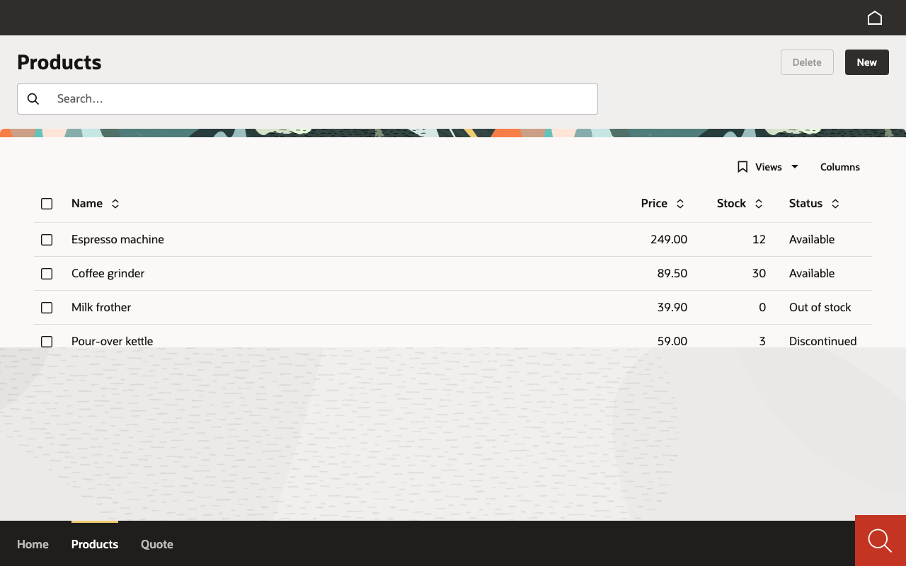

# Lab 02 · One UI, every renderer (30′)

*[Español](guide.es.md)* · Tracks: all · Code: Java `java/start` → `java/solution`; C# and Python keep lab 01's solution

Your app says **what** is on the screen, never **how** to draw it. The same answer from the server
is drawn by Vaadin, by Oracle Redwood, natively on a phone and in a desktop app. In this lab you
see it four times.

## 1. The same app on Oracle Redwood (10′)

**Java** — the renderer is a dependency. In `pom.xml` swap

```xml
<artifactId>mateu-vaadin</artifactId>
```

for

```xml
<artifactId>mateu-redwood</artifactId>
```

and restart (`mvn spring-boot:run`). The solution also adds `src/main/resources/specs/ui/project.yaml`
with `renderer: redwood`, which tells the IDE tooling (visual editor, previews) which look to use —
the running app only cares about the dependency.

**C# / Python** — no code change at all: point `MATEU_UI` at the other jar and restart.

```bash
MATEU_UI=<workshop>/renderers/mateu-redwood.jar dotnet run                      # C#
MATEU_UI=<workshop>/renderers/mateu-redwood.jar uvicorn main:app --port 8080     # Python
```

Open http://localhost:8080. The page loads Oracle JET, Spectra and the Visual Builder runtime from
**Oracle's CDN** (`static.oracle.com`), so this step needs internet; nothing of Oracle's is bundled.



> **Known gap at 3.0-beta.64 — C# and Python on Redwood.** We checked all three backends with the
> Redwood renderer: on **Java** every screen draws (above). On **C# and Python** the Redwood shell,
> menu and page titles draw but the **screen contents stay empty** (the same app on Vaadin is fine).
> If you are on those tracks, look at Redwood on Java's solution with a neighbour, or at the public
> demo https://museums-rw.ec1.mateu.io — and carry on: the rest of this lab does not depend on it.

Compare with Vaadin: same menu, same columns, same validation, same actions — a different design
system. Nothing in your code changed (Java: one dependency).

## 2. A Mateu UI on your phone (10′)

Open the **Mateu app** on your phone and add a UI — any of the three ways:

- **Scan** one of these codes (**Add a UI** › camera), or
- **tap** the link on the phone, or
- **type** the address (**Add a UI** › *Type an address instead*).

| | Scan | Link | Address |
|---|---|---|---|
| Museums — artists, works, exhibitions, loans |  | https://mateu.io/add?u=museums.ec1.mateu.io | `museums.ec1.mateu.io` |
| Space exploration |  | https://mateu.io/add?u=space.ec1.mateu.io | `space.ec1.mateu.io` |
| A hotel front office |  | https://mateu.io/add?u=frontoffice.ec1.mateu.io | `frontoffice.ec1.mateu.io` |

The app shows the UI's **domain** first and adds nothing you did not confirm. Open it: menus,
listings, forms, boards — drawn natively (Material Design 3), by the same server that serves the web.
Open the same address in your laptop's browser and compare.

A QR or a link carries **only an address** — never a password or a session. Photograph one, forward
it: at worst it adds an entry to someone's list.

## 3. A Mateu UI in the desktop app (5′)

Open the **Mateu desktop app** (the hub). Then either:

- **Add a UI** › paste `museums.ec1.mateu.io`, or
- open the link `mateu://add?u=museums.ec1.mateu.io` from your browser (macOS:
  `open "mateu://add?u=museums.ec1.mateu.io"`; Windows: `start mateu://add?u=museums.ec1.mateu.io`;
  Linux: `xdg-open "mateu://add?u=museums.ec1.mateu.io"`).

The app asks before it looks the address up, then shows the UI's name and adds it. The menu lives in
the side panel, screens open as tabs in the middle.

**Your own app on the desktop**: the desktop app accepts plain `http` for **this machine only**, so
`mateu://add?u=http://localhost:8080` opens the app you are running (IntelliJ's *Mateu App* run
configuration and VS Code's *Mateu: Open Running App in the Desktop App* do exactly that).

## 4. Optional: your own app on your phone

The phone app opens **https** addresses. Your laptop serves plain http on `localhost`, which the
phone cannot reach and would not accept. To try it, expose the app over https with a tunnel you
trust (for example `cloudflared tunnel --url http://localhost:8080`) and add the https address it
prints. *This step is not scripted or verified for the workshop — do it only if the room's network
lets you, and never with real data.*

✅ **Checkpoint**: your app on Redwood (Java) or a public UI on Redwood (C#/Python); at least one
public UI open on your phone **and** in the desktop app.

## Stretch

- In the desktop app, open two UIs and switch between them (**My UIs**).
- On the phone: **Export my UIs** — a QR with your list, addresses only.
- Java: `@App(mobileQr = true)` on `Shell` adds an **Open on mobile** button with the QR of the
  screen you are on (C# `[App(MobileQr = true)]`, Python `@app(mobile_qr=True)`).
