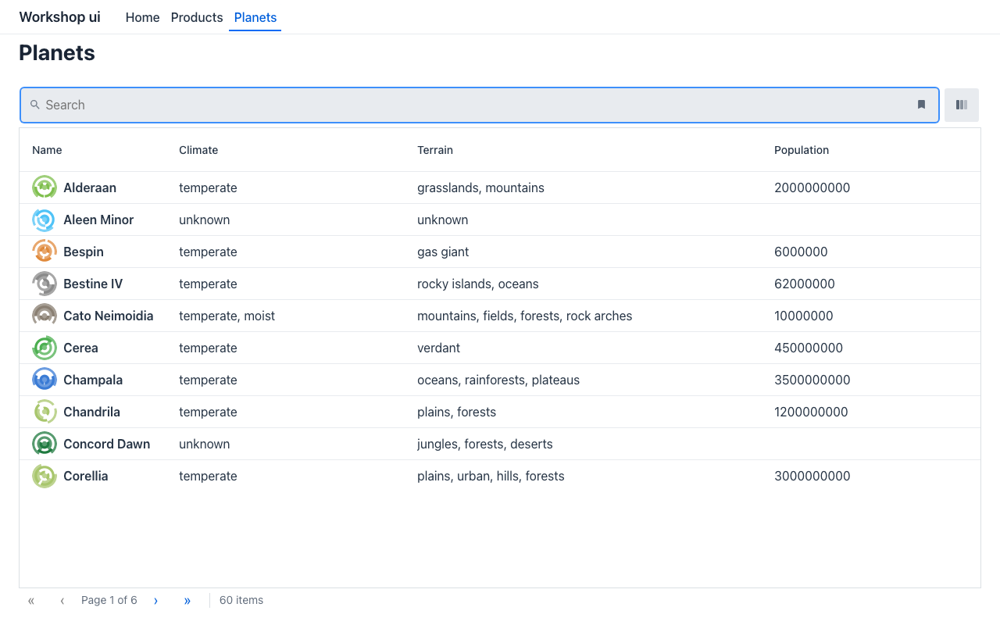

# Lab 04 · La UI como datos: YAML, el editor visual, un bundle estático (35′)

*[English](guide.md)* · Itinerarios: **todos — el mismo lab para Java, C# y Python** · Inicio: `start/` · Solución: `solution/`

El modelo que escribiste como clases en el lab 01 también puede ser **datos**: ficheros YAML bajo
`specs/ui`. El mismo wire, los mismos renderers; y sin view model detrás, una UI puede publicarse
como una **carpeta de ficheros estáticos** en cualquier CDN, **sin backend**. Aquí Maven es solo la
herramienta de build: no hay código Java.

## 1. Abre el proyecto (5′)

Genéralo (*New Project › Mateu*, autoría **YAML only, static (no backend)**, plantilla **Home +
Product listing**) o abre `labs/04-ui-as-data/start/`.

```
src/main/resources/specs/ui/
  app.ui.yaml    type: UI — el montaje: ruta base "/", sus ficheros de rutas, su ruta de inicio
  routes.yaml    type: Routes — cada ruta enlazada a un fichero de layout
  app.yaml       type: AppShell — título y menú
  home.yaml      la página de inicio (un hero con una llamada a la acción)
  products.yaml  type: Listing — con búsqueda, filtros, orden y paginación
  sources.yaml   el catálogo de fuentes REST — cada endpoint nombrado una vez, con datos de ejemplo
  project.yaml   type: Project — el renderer
.mvn/maven.config   -Dmateu.bundle.mock=true: el bundle lleva los datos de ejemplo
```

Cada fichero empieza con una línea `$schema`: tu editor autocompleta y valida cada clave.

## 2. Arráncalo con recarga en vivo (5′)

```bash
mvn mateu-bundle:dev
```

Abre http://localhost:3000 (si el puerto está ocupado pasa al siguiente libre: mira el log). Edita
cualquier YAML y guarda: el bundle se reconstruye y la página se recarga. Un fichero roto se anota en
el log y se sigue sirviendo el último bundle bueno.

## 3. Edita en el editor visual (10′)

- **IntelliJ**: abre `products.yaml` › pestaña **Visual Editor**.
- **VS Code**: abre `products.yaml` › *Reopen Editor With…* › **Mateu Visual Editor**.

El editor elige el modo según el `type:` del fichero: un formulario para `app.yaml`, una tabla de
rutas para `routes.yaml`, un lienzo para una página. En el lienzo, selecciona el listado y añade una
columna **Stock** (id `stock`, tipo de dato `integer`). O escríbela, es una línea de `products.yaml`:

```yaml
  - {type: GridColumn, id: stock, label: Stock, dataType: integer, sortable: true}
```

Los datos viven en `sources.yaml`: añade `stock:` a cada fila de ejemplo (`{id: P-001, …, stock: 12, …}`).
**▶ Play** en el editor ejecuta todo el montaje a partir de los ficheros tal como los has editado; un
montaje solo-YAML no necesita backend para eso.

## 4. Una página sobre una API real (10′)

https://swapi.mateu.io es una API pública de Star Wars que responde a navegadores de cualquier origen
(CORS) y pagina y busca en el servidor. Nómbrala una vez, en `sources.yaml`:

```yaml
  - name: planets
    description: Planets of the Star Wars galaxy
    source:
      url: >-
        https://swapi.mateu.io/api/planets?page=${state.page ?? 0}&size=${state.size ?? 10}&search=${encodeURIComponent(state.searchText
        ?? '')}
      itemsPath: content
    totalPath: totalElements
```

Una página que la usa, fichero nuevo `planets.yaml`:

```yaml
$schema: https://raw.githubusercontent.com/miguelperezcolom/mateu/v3.0-beta.64/backend/shared/uidl/uidl-schema.json
pageType: collection
type: Listing
title: Planets
pageSize: 10
searchable: true
rowsSource:
  ref: planets
columns:
  - {type: GridColumn, id: name, label: Name, identifier: true, stereotype: primary, leadingPath: image}
  - {type: GridColumn, id: climate, label: Climate}
  - {type: GridColumn, id: terrain, label: Terrain}
  - {type: GridColumn, id: population, label: Population}
```

una ruta en `routes.yaml` (`- route: planets` / `layout: planets.yaml`) y una entrada de menú en
`app.yaml` (`- type: RouteLink` / `label: Planets` / `route: planets`).



## 5. Publícalo sin backend (5′)

```bash
mvn package                           # → target/mateu-bundle/ (index.html, manifest.json, assets/)
npx serve -s target/mateu-bundle      # cualquier hosting estático con fallback de SPA
```

El build pasa un **chequeo de seguridad estática**: lo que necesitaría un servidor (un botón sin ruta
ni acción REST, una fuente `proxy: true`, un `${secret.…}`) rompe el build en vez de romper en
producción. `target/mateu-bundle` es lo que subirías a Netlify, S3 + CloudFront, nginx… (Netlify lee
el `_redirects` que se incluye).

✅ **Checkpoint**: el bundle servido muestra **Products** con la columna **Stock** (datos de ejemplo)
y **Planets** con 60 planetas en 6 páginas, con búsqueda, sin ningún servidor tuyo en marcha.

## Extra

- Quita el modo de ejemplo (borra `.mvn/maven.config`), apunta `products` a una URL real y reconstruye.
- Reapunta un bundle desplegado a otra API editando `sources` en `target/mateu-bundle/manifest.json`,
  sin reconstruir.
- `-Dmateu.dev.host=0.0.0.0` en `mateu-bundle:dev` imprime un QR que añade la UI a un móvil (una build
  de desarrollo de la app Mateu acepta http; la de la tienda necesita https).
- Pide a tu asistente de IA que añada una página: el `AGENTS.md` del proyecto y el skill `mateu-yaml`
  le dan las reglas (editar solo `specs/ui`, fuentes con nombre, nada de secretos).
