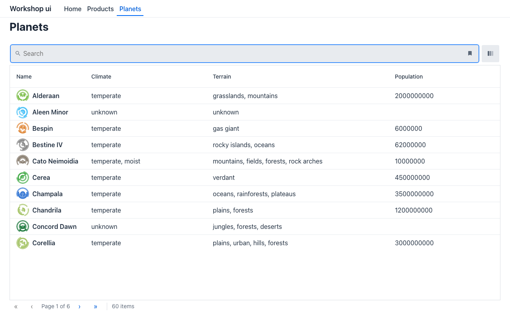

# Lab 04 · UI as data: YAML, the visual editor, a static bundle (35′)

*[Español](guide.es.md)* · Tracks: **all — the same lab for Java, C# and Python** · Start: `start/` · Solution: `solution/`

The model you wrote as classes in lab 01 can also be **data**: YAML files under `specs/ui`. Same wire,
same renderers — and with no view model behind it, a UI can ship as a **folder of static files** to
any CDN, with **no backend at all**. You need Maven here only as a build tool: there is no Java code.

## 1. Open the project (5′)

Generate it (*New Project › Mateu*, authoring **YAML only, static (no backend)**, template **Home +
Product listing**) or open `labs/04-ui-as-data/start/`.

```
src/main/resources/specs/ui/
  app.ui.yaml    type: UI — the mount: base path "/", its route files, its home route
  routes.yaml    type: Routes — each route bound to a layout file
  app.yaml       type: AppShell — title and menu
  home.yaml      the home page (a hero with a call to action)
  products.yaml  type: Listing — searchable, filterable, sortable, paged
  sources.yaml   the REST source catalogue — every endpoint named once, with sample data
  project.yaml   type: Project — the renderer
.mvn/maven.config   -Dmateu.bundle.mock=true: ship the sources' sample data
```

Every file starts with a `$schema` line: your editor autocompletes and checks every key.

## 2. Run it with live reload (5′)

```bash
mvn mateu-bundle:dev
```

Open http://localhost:3000 (a busy port moves to the next free one — read the log). Edit any YAML
and save: the bundle is rebuilt and the page reloads. A broken file is logged and the last good
bundle keeps being served.

## 3. Edit in the visual editor (10′)

- **IntelliJ**: open `products.yaml` › the **Visual Editor** tab.
- **VS Code**: open `products.yaml` › *Reopen Editor With…* › **Mateu Visual Editor**.

The editor picks its mode from the file's `type:` — a form for `app.yaml`, a route table for
`routes.yaml`, a canvas for a page. In the canvas, select the listing and add a column **Stock**
(id `stock`, data type `integer`). Or type it — it is one line of `products.yaml`:

```yaml
  - {type: GridColumn, id: stock, label: Stock, dataType: integer, sortable: true}
```

The data lives in `sources.yaml`: add `stock:` to each sample row (`{id: P-001, …, stock: 12, …}`).
**▶ Play** in the editor runs the whole mount from the files as you have edited them — a YAML-only
mount needs no backend for that.

## 4. A page over a real API (10′)

https://swapi.mateu.io is a public Star Wars API that answers browsers from any origin (CORS) and
pages and searches on the server. Name it once, in `sources.yaml`:

```yaml
  - name: planets
    description: Planets of the Star Wars galaxy
    source:
      url: >-
        https://swapi.mateu.io/api/planets?page=${state.page ?? 0}&size=${state.size ?? 10}&search=${encodeURIComponent(state.searchText
        ?? '')}
      itemsPath: content
    totalPath: totalElements
```

A page that uses it — new file `planets.yaml`:

```yaml
$schema: https://raw.githubusercontent.com/miguelperezcolom/mateu/v3.0-beta.64/backend/shared/uidl/uidl-schema.json
pageType: collection
type: Listing
title: Planets
pageSize: 10
searchable: true
rowsSource:
  ref: planets
columns:
  - {type: GridColumn, id: name, label: Name, identifier: true, stereotype: primary, leadingPath: image}
  - {type: GridColumn, id: climate, label: Climate}
  - {type: GridColumn, id: terrain, label: Terrain}
  - {type: GridColumn, id: population, label: Population}
```

a route in `routes.yaml` (`- route: planets` / `layout: planets.yaml`) and a menu entry in `app.yaml`
(`- type: RouteLink` / `label: Planets` / `route: planets`).



## 5. Ship it with no backend (5′)

```bash
mvn package                           # → target/mateu-bundle/ (index.html, manifest.json, assets/)
npx serve -s target/mateu-bundle      # any static host with an SPA fallback
```

The build runs a **static-safety check**: anything that would need a server — a button with neither
a route nor a REST action, a `proxy: true` source, a `${secret.…}` — fails the build instead of
failing in production. `target/mateu-bundle` is what you would drop on Netlify, S3 + CloudFront,
nginx… (Netlify reads the shipped `_redirects`).

✅ **Checkpoint**: the served bundle shows **Products** with a **Stock** column (sample data) and
**Planets** with 60 planets over 6 pages, searchable — with no server of yours running.

## Stretch

- Turn sample mode off (delete `.mvn/maven.config`), point `products` at a real URL and rebuild.
- Re-point a deployed bundle at another API by editing `sources` in `target/mateu-bundle/manifest.json`
  — no rebuild.
- `-Dmateu.dev.host=0.0.0.0` on `mateu-bundle:dev` prints a QR that adds the UI to a phone (a
  development build of the Mateu app accepts plain http; the store app needs https).
- Ask your AI assistant to add a page: the project's `AGENTS.md` and the `mateu-yaml` skill tell it
  the rules (edit `specs/ui` only, named sources, no secrets).
