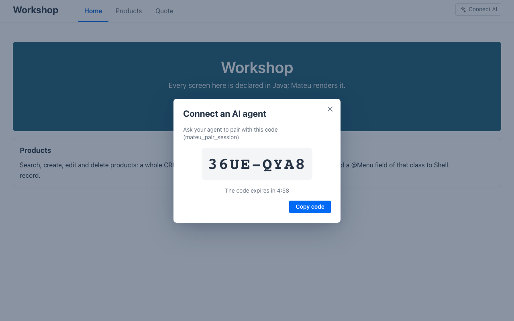
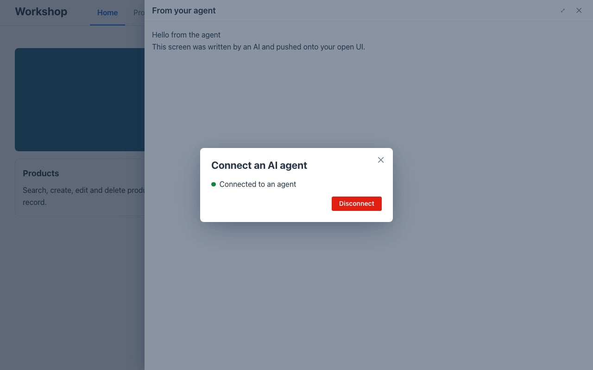

# Lab 05 · Agentes de IA por MCP (30′)

*[English](guide.md)* · Itinerarios: **Java**, **C#**, **Python** (un ajuste en cada uno; el resto es común) · Inicio: `<itinerario>/start` (= solución del lab 03) · Solución: `<itinerario>/solution`

Como una pantalla Mateu es un **modelo**, un agente de IA puede leerla y actuar sobre ella igual que
un renderer: sin scraping, sin clics. Tu app puede ser un **servidor MCP**: un agente lista sus
pantallas, describe una (campos, acciones, filas), ejecuta una acción, busca en un listado, todo con
las mismas reglas de servidor que un usuario. También puede **escribir** una pantalla (validada contra
el esquema) y **enviarla** a una UI que el usuario tiene abierta.

## 1. Actívalo (5′)

Viene apagado: da a cualquier llamante una forma programática de manejar todas las pantallas, así
que lo decide la app.

**Java** — `src/main/resources/application.properties`:

```properties
mateu.mcp.enabled=true
mateu.mcp.push.enabled=true
```

**C#** — `Program.cs`:

```csharp
builder.Services.AddMateu(o =>
{
    o.Mcp = true;
    o.McpPush = true;
}, Assembly.GetExecutingAssembly());
```

**Python** — `main.py`:

```python
add_mateu(app, views, mcp=True, mcp_push=True)
```

(O, en cualquiera, el entorno: `MATEU_MCP_ENABLED=true MATEU_MCP_PUSH_ENABLED=true`.)

Reinicia (C#/Python con `MATEU_UI=<workshop>/renderers/mateu-vaadin.jar`, como en el lab 01). El
endpoint es `POST http://localhost:8080/mateu/mcp`. Compruébalo sin ningún agente:

```bash
curl -s -X POST http://localhost:8080/mateu/mcp -H 'content-type: application/json' \
  -d '{"jsonrpc":"2.0","id":1,"method":"tools/list"}'
```

Deberías ver 13 herramientas: `mateu_list_routes`, `mateu_describe_screen`, `mateu_run_action`,
`mateu_search`, las de autoría (`mateu_list_components`, `mateu_get_component_schema`,
`mateu_validate_uidl`, `mateu_preview_uidl`) y las de envío en vivo (`mateu_list_sessions`,
`mateu_pair_session`, `mateu_push_ui`, `mateu_navigate`, `mateu_dispatch_event`). En `start/` la
misma llamada responde 404.

## 2. Conecta tu agente y deja que opere (10′)

Claude Code:

```bash
claude mcp add --transport http mateu http://localhost:8080/mateu/mcp
```

(Cualquier cliente MCP sirve: registra un servidor HTTP en esa URL.) Y pídele, con tus palabras:

- *"¿Qué pantallas tiene la app del servidor MCP mateu?"* → `mateu_list_routes`
- *"Describe la pantalla quote."* → `mateu_describe_screen`: 4 campos, la acción `calculate`
- *"Hazme un presupuesto: 3 unidades a 10 con un 10 % de descuento."* → `mateu_run_action`: total **27**
- *"¿Qué productos contienen 'grinder'?"* → `mateu_search`

Lo mismo a mano, si no tienes agente en la mesa:

```bash
curl -s -X POST http://localhost:8080/mateu/mcp -H 'content-type: application/json' \
  -d '{"jsonrpc":"2.0","id":2,"method":"tools/call","params":{"name":"mateu_run_action","arguments":{"route":"quote","actionId":"calculate","componentState":{"quantity":3,"unitPrice":10,"discount":10}}}}'
```

→ `"total" : 27.0` y el mensaje `Total: 27.0`.

El agente pasa por **las mismas reglas de servidor que un usuario**: validación, `@EyesOnly`… En el
lab 06 el descuento pasa a ser un campo de responsable: un agente que llame como dependiente tampoco
lo verá.

## 3. El agente escribe una pantalla y te la pone delante (10′)

1. En el navegador, la cabecera de tu app tiene ahora **Connect AI**. Púlsalo: un código de un solo
   uso (`36UE-QYA8`), válido cinco minutos.

   

2. Dile a tu agente: *"Empareja con la sesión de Mateu usando el código 36UE-QYA8. Después escribe
   una página que salude al taller en dos líneas, valídala y enséñamela en un drawer titulado 'From
   your agent'."* Llama a `mateu_pair_session`, escribe el YAML (buscando componentes con
   `mateu_list_components`), lo comprueba con `mateu_validate_uidl` hasta que no hay errores y lo
   envía con `mateu_push_ui`. Nunca se envía nada con errores de validación.

   

3. **Disconnect**, en el mismo diálogo, quita el emparejamiento al momento.

Lo que te protege: un código vale una vez y caduca en cinco minutos; una página enviada es **no
confiable** (sin scripts, sin HTML crudo, sin código remoto); el agente solo alcanza las sesiones
emparejadas con él (o las de su propio usuario); todo queda registrado en el servidor.

✅ **Checkpoint**: tu agente (o `curl`) ejecutó `calculate` y obtuvo 27; una página escrita por el
agente apareció en un drawer sobre tu app abierta.

## Llega en la próxima versión (no está en 3.0-beta.64)

Esto existe en el repositorio pero **aún no se ha publicado**. No lo busques en la versión del
taller; quien imparte puede enseñarlo con una build de `master`.

- **La app de escritorio como servidor MCP**: se activa en *Settings › Mateu › AI agents (MCP)* de la
  app de escritorio, para que un agente maneje las UIs abiertas en ella.
- **Manejar la sesión en vivo de un usuario desde el servidor**: `mateu_get_session_screen`,
  `set_session_fields`, `run_session_action`; un agente lee y rellena la pantalla que está viendo un
  usuario emparejado. Ver el [lab 07](../07-stretch/guide.es.md).

(En 3.0-beta.64 la app de escritorio ya tiene **Connect AI**, una acción de la barra de
herramientas, así que el envío del paso 3 también puede ir a una ventana de escritorio. Verificamos
el envío en el renderer web con los tres lenguajes, no en la app de escritorio: pruébalo y
cuéntanoslo.)

## Extra

- Pide al agente que envíe la página al área de **contenido** en vez de a un drawer
  (`target: content`), o que te lleve a otra pantalla (`mateu_navigate` con `route: products`).
- Cualquier backend, sin ningún ajuste: el sidecar sin dependencias `frontend/mcp-server/index.mjs`
  habla solo el wire público (`MATEU_BASE_URL=http://localhost:8080`).
- El modo dev (`mateu.dev=true` / `MATEU_DEV=true`) añade `mateu_save_spec`: el agente escribe una
  página YAML en `specs/ui` y la recarga en vivo la muestra.
