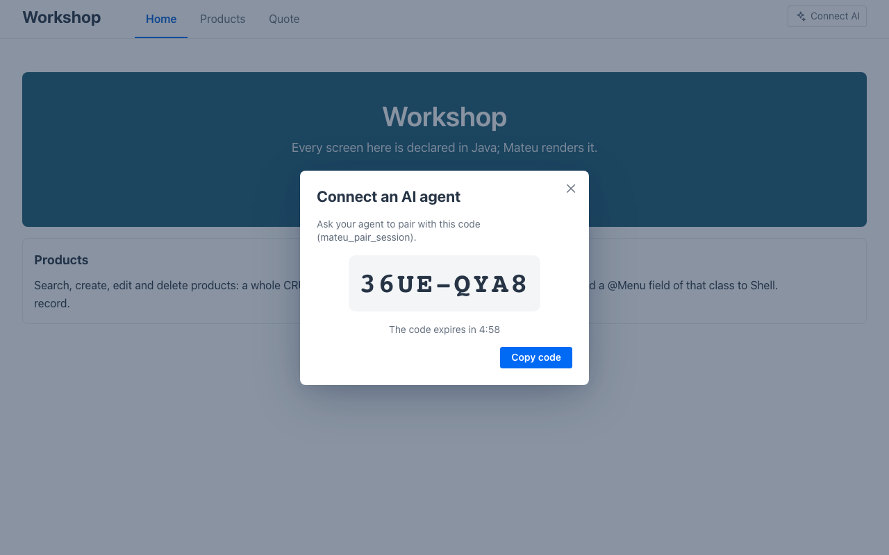
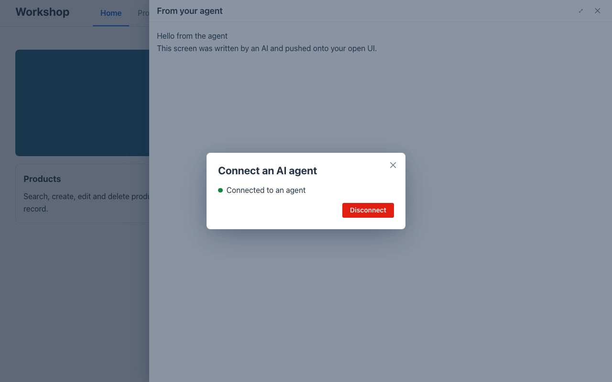

# Lab 05 · AI agents over MCP (30′)

*[Español](guide.es.md)* · Tracks: **Java**, **C#**, **Python** (one setting each; the rest is shared) · Start: `<track>/start` (= lab 03's solution) · Solution: `<track>/solution`

Because a Mateu screen is a **model**, an AI agent can read it and act on it the way a renderer does —
no scraping, no clicking. Your app can be an **MCP server**: an agent lists its screens, describes
one (fields, actions, rows), runs an action, searches a listing — through the same server-side rules
as a user. It can also **author** a screen (validated against the schema) and **push** it onto a UI
the user has open.

## 1. Turn it on (5′)

Off by default — it gives any caller a programmatic way to drive every screen, so the app decides.

**Java** — `src/main/resources/application.properties`:

```properties
mateu.mcp.enabled=true
mateu.mcp.push.enabled=true
```

**C#** — `Program.cs`:

```csharp
builder.Services.AddMateu(o =>
{
    o.Mcp = true;
    o.McpPush = true;
}, Assembly.GetExecutingAssembly());
```

**Python** — `main.py`:

```python
add_mateu(app, views, mcp=True, mcp_push=True)
```

(Or, on any of them, the environment: `MATEU_MCP_ENABLED=true MATEU_MCP_PUSH_ENABLED=true`.)

Restart (C#/Python with `MATEU_UI=<workshop>/renderers/mateu-vaadin.jar`, as in lab 01). The endpoint
is `POST http://localhost:8080/mateu/mcp`. Check it without any agent:

```bash
curl -s -X POST http://localhost:8080/mateu/mcp -H 'content-type: application/json' \
  -d '{"jsonrpc":"2.0","id":1,"method":"tools/list"}'
```

You should see 13 tools: `mateu_list_routes`, `mateu_describe_screen`, `mateu_run_action`,
`mateu_search`, the authoring ones (`mateu_list_components`, `mateu_get_component_schema`,
`mateu_validate_uidl`, `mateu_preview_uidl`) and the live-push ones (`mateu_list_sessions`,
`mateu_pair_session`, `mateu_push_ui`, `mateu_navigate`, `mateu_dispatch_event`). On `start/` the
same call answers 404.

## 2. Connect your agent and let it operate (10′)

Claude Code:

```bash
claude mcp add --transport http mateu http://localhost:8080/mateu/mcp
```

(Any MCP client works: register an HTTP server at that URL.) Then ask it, in plain words:

- *"Which screens does the app at the mateu MCP server have?"* → `mateu_list_routes`
- *"Describe the quote screen."* → `mateu_describe_screen` — 4 fields, the `calculate` action
- *"Work out a quote: 3 units at 10 with a 10% discount."* → `mateu_run_action` — total **27**
- *"Which products have 'grinder' in them?"* → `mateu_search`

The same thing by hand, if you have no agent at the table:

```bash
curl -s -X POST http://localhost:8080/mateu/mcp -H 'content-type: application/json' \
  -d '{"jsonrpc":"2.0","id":2,"method":"tools/call","params":{"name":"mateu_run_action","arguments":{"route":"quote","actionId":"calculate","componentState":{"quantity":3,"unitPrice":10,"discount":10}}}}'
```

→ `"total" : 27.0` and the message `Total: 27.0`.

The agent goes through **the same server-side rules as a user**: validation, `@EyesOnly`… In lab 06
the discount becomes a manager's field — an agent calling as a clerk will not see it either.

## 3. The agent writes a screen and puts it in front of you (10′)

1. In the browser, your app's header now has **Connect AI**. Click it: a one-time code
   (`36UE-QYA8`), valid for five minutes.

   

2. Tell your agent: *"Pair with the Mateu session using code 36UE-QYA8. Then write a page that
   greets the workshop in two lines, validate it, and show it to me in a drawer titled 'From your
   agent'."* It calls `mateu_pair_session`, writes the YAML (looking components up with
   `mateu_list_components`), checks it with `mateu_validate_uidl` until there are no errors, and
   sends it with `mateu_push_ui`. Nothing with validation errors is ever sent.

   

3. **Disconnect** in the same dialog removes the pairing at once.

What protects you: a code works once and dies in five minutes; a pushed page is **untrusted** — no
scripts, no raw HTML, no remote code; the agent only reaches sessions paired to it (or its own
user's); everything is logged on the server.

✅ **Checkpoint**: your agent (or `curl`) ran `calculate` and got 27; a page written by the agent
appeared in a drawer over your open app.

## Coming in the next release (not in 3.0-beta.64)

These exist in the repository but have **not been released** yet. Do not look for them in the
workshop's version; the instructor may demo them from a build of `master`.

- **The desktop app as an MCP server** — opt-in in the desktop app's *Settings › Mateu › AI agents
  (MCP)*, so an agent can operate the UIs open in your desktop app.
- **Driving a user's live session from the server** — `mateu_get_session_screen`,
  `set_session_fields`, `run_session_action`: an agent reads and fills the screen a paired user is
  looking at. See [lab 07](../07-stretch/guide.md).

(In 3.0-beta.64 the desktop app already has **Connect AI** — a toolbar action — so the push of step 3
can target a desktop window too. We verified the push on the web renderer in the three languages, not
on the desktop app: try it, and tell us.)

## Stretch

- Ask the agent to push into the **content** area instead of a drawer (`target: content`), or to
  navigate you somewhere (`mateu_navigate` with `route: products`).
- Any backend, no setting at all: the zero-dependency sidecar `frontend/mcp-server/index.mjs` speaks
  only the public wire (`MATEU_BASE_URL=http://localhost:8080`).
- Dev mode (`mateu.dev=true` / `MATEU_DEV=true`) adds `mateu_save_spec`: the agent writes a YAML page
  into `specs/ui` and live reload shows it.
