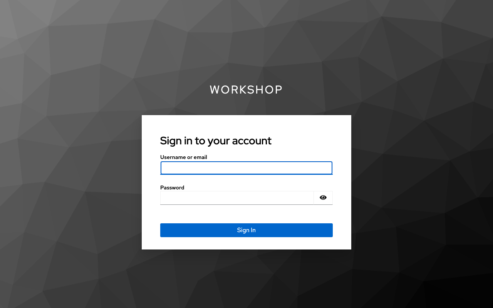
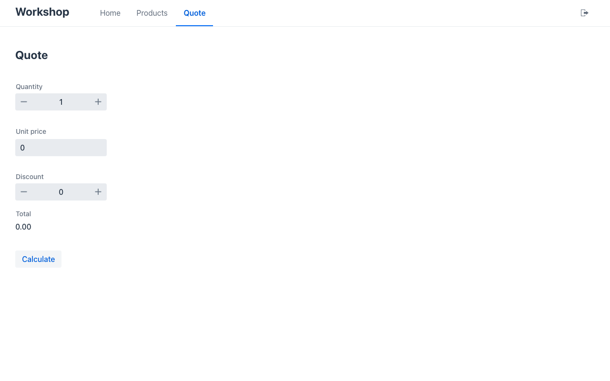
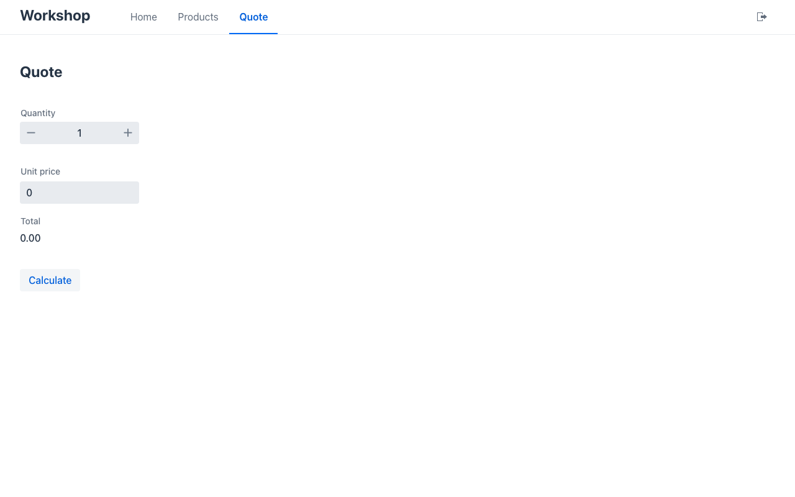

# Lab 06 · Inicio de sesión (30′)

*[English](guide.md)* · Itinerarios: **Java**, **C#**, **Python** · Inicio: `<itinerario>/start` (= solución del lab 03) · Solución: `<itinerario>/solution` · Común: `keycloak/`

Mateu solo hace UI, y entrar es UI: Mateu **ofrece** el inicio de sesión a todos los clientes (web,
móvil, escritorio) y el navegador ejecuta OpenID Connect contra tu proveedor de identidad.
**Comprobar quién llama no es UI**: tu framework valida el token, como para cualquier otro cliente de
tu API, y Mateu lee la identidad que estableció, para `@EyesOnly`, `@ReadOnlyUnless`, `@DisabledUnless`.

## 1. Arranca Keycloak (3′)

```bash
docker compose -f labs/06-sign-in/keycloak/compose.yml up -d
```

Ya trae todo: realm `workshop`, cliente público `mateu-ui` (Authorization Code + PKCE, sin secreto),
los usuarios **ada / ada** (rol `manager`) y **bob / bob** (rol `clerk`), y un mapper que pone los
roles del realm en un claim `roles` de primer nivel. Issuer: `http://localhost:8180/realms/workshop`
(consola de administración http://localhost:8180, admin / admin). Tu app debe correr en **http://localhost:8080**: es la URI de redirección que admite el cliente. *Solo para el taller: modo dev,
http sin cifrar, contraseñas conocidas.*

## 2. Ofrece el inicio de sesión, valida el token (12′)

**Java** — `pom.xml`:

```xml
<dependency>
    <groupId>org.springframework.boot</groupId>
    <artifactId>spring-boot-starter-security-oauth2-resource-server</artifactId>
</dependency>
```

`application.properties`:

```properties
workshop.issuer=${WORKSHOP_ISSUER:http://localhost:8180/realms/workshop}
mateu.auth.providers=keycloak
mateu.auth.providers.keycloak.label=Workshop SSO
mateu.auth.providers.keycloak.issuer=${workshop.issuer}
mateu.auth.providers.keycloak.client-id=mateu-ui
mateu.auth.providers.keycloak.scopes=openid,profile,email
spring.security.oauth2.resourceserver.jwt.issuer-uri=${workshop.issuer}
```

y un `SecurityConfig` (cópialo de `java/solution`): la página sigue abierta, cada llamada a
`/mateu/v3/` necesita un token válido y responde **401** (no una redirección) sin él. Ese 401 es lo
que hace que el cliente inicie sesión.

**C#** — `dotnet add package Microsoft.AspNetCore.Authentication.JwtBearer --version 10.0.15` y en
`Program.cs` (fichero completo en `dotnet/solution`):

```csharp
builder.Services.AddMateu(o =>
{
    o.SignIn = [new SignInProvider("keycloak") { Label = "Workshop SSO", Issuer = issuer, ClientId = "mateu-ui" }];
}, Assembly.GetExecutingAssembly());

builder.Services.AddAuthentication(JwtBearerDefaults.AuthenticationScheme)
    .AddJwtBearer(o =>
    {
        o.Authority = issuer;
        o.Audience = "mateu-ui";
        o.RequireHttpsMetadata = false; // el Keycloak del taller es http en localhost
        o.MapInboundClaims = false;     // conserva los nombres de claim de Keycloak ("roles")
    });
```

más `app.UseAuthentication()` y un pequeño middleware que responde 401 a una llamada a `/mateu/v3/`
sin autenticar.

**Python** — añade `pyjwt[crypto]` a `requirements.txt` (`pip install -r requirements.txt`) y en
`main.py` (fichero completo en `python/solution`): un middleware que verifica el token bearer contra
las claves de Keycloak (`jwt.PyJWKClient`) y pone `request.state.mateu_identity =
identity_from_claims(claims)`, respondiendo 401 sin uno válido; y

```python
add_mateu(app, views,
          sign_in=[SignInProvider("keycloak", label="Workshop SSO", issuer=ISSUER, client_id="mateu-ui")])
```

Reinicia (C#/Python con `MATEU_UI=<workshop>/renderers/mateu-vaadin.jar`) y abre
http://localhost:8080: vas directo a Keycloak (un solo proveedor = sin selector).



## 3. Un campo que solo ve un responsable (10′)

Solo un responsable puede hacer descuento. Una anotación en `discount`:

| Java | C# | Python |
|---|---|---|
| `@EyesOnly(roles = "manager")` | `[EyesOnly(Roles = ["manager"])]` | `Annotated[int, Min(0), Max(100), EyesOnly(roles=("manager",))]` |

Se aplica **en el servidor**, para todos los renderers y también para los agentes MCP: a cualquier
otro no se le envía el campo, y si manda un valor se descarta.

Entra como **ada**: Quote tiene **Discount**. Sal (el icono de la cabecera) y entra como **bob**: sin
Discount.

| ada (manager) | bob (clerk) |
|---|---|
|  |  |

Pruébalo, sin Keycloak: el arnés abre una pantalla **como** una identidad.

```java
assertFalse(mateu.open("/quote", Identity.withRoles("clerk")).hasField("discount"));
assertTrue(mateu.open("/quote", Identity.withRoles("manager")).hasField("discount"));
```

```csharp
Assert.False(mateu.Open("/quote", MateuTest.User("bob", "clerk")).HasField("discount"));
```

```python
assert not MateuTest(views).open("/quote", MateuTest.user("clerk")).has_field("discount")
```

Tu test de `calculate` del lab 03 ahora también necesita un responsable: arréglalo (la solución abre
el presupuesto como tal).

✅ **Checkpoint**: una llamada anónima a `/mateu/v3/sync/quote` responde 401; ada ve Discount, bob no;
los tests del arnés lo demuestran sin Keycloak.

## El menú de usuario — próxima versión

En `master` (no en 3.0-beta.64) la cabecera muestra **quién** ha entrado: foto o iniciales, nombre,
e-mail y **Sign out** en un menú, leídos de la identidad que autenticó tu framework
(`name`/`preferred_username`, `email`, `picture`). En 3.0-beta.64 tienes el botón **Sign out** simple
que viste arriba.

## Extra

- `@ReadOnlyUnless(roles = "manager")` en `unitPrice`: los dependientes ven el precio pero no lo cambian.
- GitHub en vez de Keycloak (un proveedor `redirect`: tu framework hace el login y guarda una sesión):
  `demo/demo-sign-in` en este repositorio es un ejemplo Spring ejecutable; guía
  https://mateu.io/deploy/sign-in/.
- El mismo cliente de Keycloak admite también `mateu://auth` (el móvil) y el device grant (la app de
  escritorio): las recetas están en la guía de inicio de sesión.
