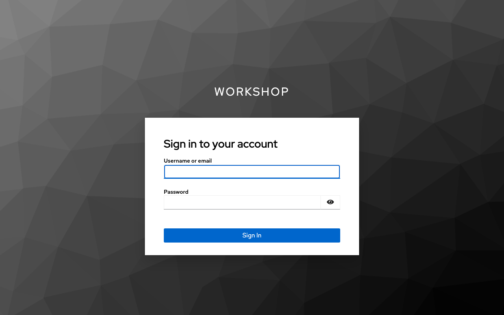
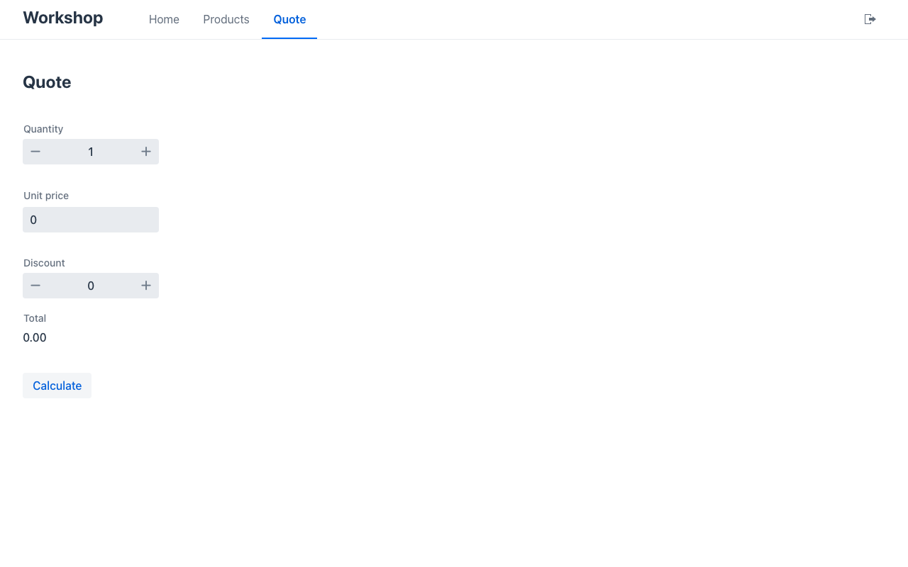
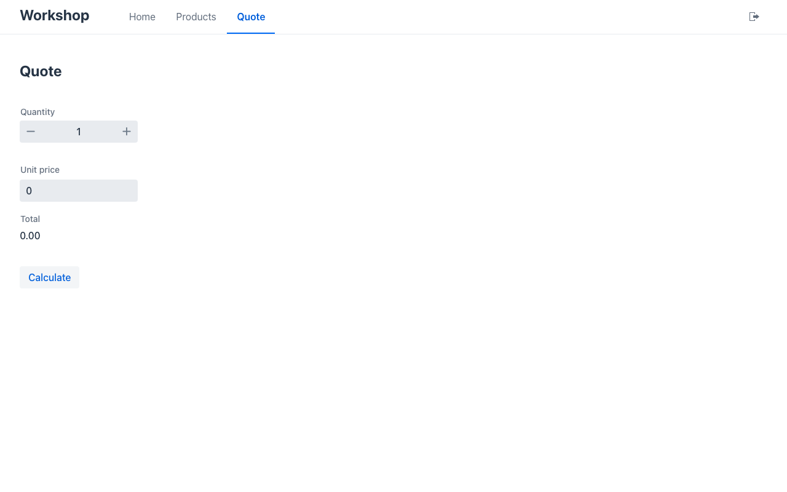

# Lab 06 · Sign-in (30′)

*[Español](guide.es.md)* · Tracks: **Java**, **C#**, **Python** · Start: `<track>/start` (= lab 03's solution) · Solution: `<track>/solution` · Shared: `keycloak/`

Mateu ships UI only, and signing in is UI: Mateu **offers** the sign-in to every client (web, phone,
desktop) and the browser runs OpenID Connect against your identity provider. **Checking who is
calling is not UI**: your framework validates the token, as for any other client of your API, and
Mateu reads the identity it established — for `@EyesOnly`, `@ReadOnlyUnless`, `@DisabledUnless`.

## 1. Start Keycloak (3′)

```bash
docker compose -f labs/06-sign-in/keycloak/compose.yml up -d
```

Everything is already in it: realm `workshop`, public client `mateu-ui` (Authorization Code + PKCE,
no secret), users **ada / ada** (role `manager`) and **bob / bob** (role `clerk`), and a mapper that
puts the realm roles in a top-level `roles` claim. Issuer: `http://localhost:8180/realms/workshop`
(admin console http://localhost:8180, admin / admin). Your app must run on **http://localhost:8080** — the redirect URI the client allows. *Workshop only: dev mode, plain http, known
passwords.*

## 2. Offer the sign-in, validate the token (12′)

**Java** — `pom.xml`:

```xml
<dependency>
    <groupId>org.springframework.boot</groupId>
    <artifactId>spring-boot-starter-security-oauth2-resource-server</artifactId>
</dependency>
```

`application.properties`:

```properties
workshop.issuer=${WORKSHOP_ISSUER:http://localhost:8180/realms/workshop}
mateu.auth.providers=keycloak
mateu.auth.providers.keycloak.label=Workshop SSO
mateu.auth.providers.keycloak.issuer=${workshop.issuer}
mateu.auth.providers.keycloak.client-id=mateu-ui
mateu.auth.providers.keycloak.scopes=openid,profile,email
spring.security.oauth2.resourceserver.jwt.issuer-uri=${workshop.issuer}
```

and a `SecurityConfig` (copy it from `java/solution`): the page stays open, every `/mateu/v3/` call
needs a valid token and answers **401** — not a redirect — without one. That 401 is what makes the
client sign in.

**C#** — `dotnet add package Microsoft.AspNetCore.Authentication.JwtBearer --version 10.0.15`, then in
`Program.cs` (full file in `dotnet/solution`):

```csharp
builder.Services.AddMateu(o =>
{
    o.SignIn = [new SignInProvider("keycloak") { Label = "Workshop SSO", Issuer = issuer, ClientId = "mateu-ui" }];
}, Assembly.GetExecutingAssembly());

builder.Services.AddAuthentication(JwtBearerDefaults.AuthenticationScheme)
    .AddJwtBearer(o =>
    {
        o.Authority = issuer;
        o.Audience = "mateu-ui";
        o.RequireHttpsMetadata = false; // the workshop's Keycloak is plain http on localhost
        o.MapInboundClaims = false;     // keep Keycloak's claim names ("roles")
    });
```

plus `app.UseAuthentication()` and a small middleware that answers 401 to an unauthenticated
`/mateu/v3/` call.

**Python** — add `pyjwt[crypto]` to `requirements.txt` (`pip install -r requirements.txt`), then in
`main.py` (full file in `python/solution`): a middleware that verifies the bearer token against
Keycloak's keys (`jwt.PyJWKClient`) and sets `request.state.mateu_identity =
identity_from_claims(claims)`, answering 401 without a valid one; and

```python
add_mateu(app, views,
          sign_in=[SignInProvider("keycloak", label="Workshop SSO", issuer=ISSUER, client_id="mateu-ui")])
```

Restart (C#/Python with `MATEU_UI=<workshop>/renderers/mateu-vaadin.jar`) and open
http://localhost:8080: you go straight to Keycloak (one provider = no chooser).



## 3. A field only a manager sees (10′)

Only a manager may give a discount. One annotation on `discount`:

| Java | C# | Python |
|---|---|---|
| `@EyesOnly(roles = "manager")` | `[EyesOnly(Roles = ["manager"])]` | `Annotated[int, Min(0), Max(100), EyesOnly(roles=("manager",))]` |

It is applied **on the server**, for every renderer and for MCP agents alike: for anybody else the
field is not sent, and a value they send is dropped.

Sign in as **ada**: the Quote has a **Discount**. Sign out (the icon in the header) and sign in as
**bob**: no Discount.

| ada (manager) | bob (clerk) |
|---|---|
|  |  |

Test it — no Keycloak needed: the harness opens a screen **as** an identity.

```java
assertFalse(mateu.open("/quote", Identity.withRoles("clerk")).hasField("discount"));
assertTrue(mateu.open("/quote", Identity.withRoles("manager")).hasField("discount"));
```

```csharp
Assert.False(mateu.Open("/quote", MateuTest.User("bob", "clerk")).HasField("discount"));
```

```python
assert not MateuTest(views).open("/quote", MateuTest.user("clerk")).has_field("discount")
```

Your lab 03 test of `calculate` now needs a manager too — fix it (the solution opens the quote as one).

✅ **Checkpoint**: an anonymous call to `/mateu/v3/sync/quote` answers 401; ada sees Discount, bob
does not; the harness tests prove both without Keycloak.

## The user menu — next release

On `master` (not in 3.0-beta.64) the header shows **who** is signed in: picture or initials, name,
e-mail and **Sign out** in a menu, read from the identity your framework authenticated
(`name`/`preferred_username`, `email`, `picture`). In 3.0-beta.64 you get the plain **Sign out**
button you saw above.

## Stretch

- `@ReadOnlyUnless(roles = "manager")` on `unitPrice`: clerks see the price but cannot change it.
- GitHub instead of Keycloak (a `redirect` provider: your framework owns the login and keeps a
  session) — `demo/demo-sign-in` in this repository is a runnable Spring example; guide
  https://mateu.io/deploy/sign-in/.
- The same Keycloak client also allows `mateu://auth` (the phone) and the device grant (the desktop
  app) — the recipes are in the sign-in guide.
